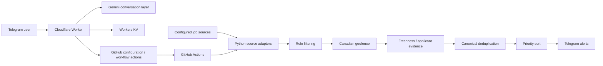
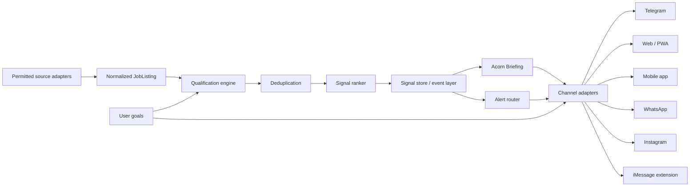

# 🌰 Acorn AI

[](https://github.com/mtk7zt/Acorn/actions/workflows/job_tracker.yml)
[](https://www.python.org/downloads/)
[](https://workers.cloudflare.com/)
[](https://deepmind.google/technologies/gemini/)
[](docs/PROJECTED_ARCHITECTURE_SPECIFICATION.md)
[](LICENSE)

> **Be first to what matters.**

Acorn is a Canadian-first career intelligence engine that keeps watch for relevant
tech opportunities, filters noise, prioritizes timing, and brings worthwhile roles
to the user instead of asking the user to spend the day refreshing job boards.

The current founder preview runs through a private Telegram experience backed by a
Python discovery pipeline, GitHub Actions, a Cloudflare Worker, and Gemini-assisted
natural-language controls.

Acorn is evolving around two product primitives:

- **Acorn Signal** — one qualified opportunity with a clear, evidence-based reason
  it deserves attention.
- **Acorn Briefing** — a small, curated set of Signals delivered when something is
  actually worth the user's time.

Acorn itself is a living acorn and personal career scout. Its mini-acorn **Scouts**
represent the background search system across the product experience.

---

## Product status

**Current:** private founder prototype / active Telegram implementation.

The repository currently implements:

- Scheduled and manually triggered job-discovery runs
- Configurable role tracking
- Canadian/GTA-first geographic filtering
- Freshness and applicant-evidence ranking
- Repost/saturation suppression
- Canonical source-ID + fingerprint deduplication
- Telegram job alerts and controls
- Natural-language role/settings actions through the edge assistant
- PII-redacted ATS resume mode
- User-triggered conversation-memory deletion

The following are product directions and are not represented as generally available
features yet:

- Acorn Signal and Acorn Briefing UI
- Public web product
- Native mobile app
- WhatsApp integration
- Instagram DM integration
- iOS/iMessage extension
- Multi-user accounts and per-user persistent state

---

## Product principles

### Attention over volume

Acorn should surface fewer, better opportunities rather than becoming another
infinite job feed.

### Timing with provenance

Freshness, applicant counts, source evidence, and relevance are separate signals.
Acorn must never present an inferred applicant count as a reported fact.

### Canada first

The current prototype prioritizes the Greater Toronto Area and Canada-wide remote
roles. Geographic coverage can expand without changing the core model.

### Privacy by design

Resume analysis is designed to redact common identifiers in memory before matching.
Privacy claims must remain scoped to the paths that actually provide those controls.

### Evidence over invention

Acorn must never fabricate candidate achievements, experience, credentials, or
resume metrics. Suggested resume language must preserve user-provided evidence.

---

## Features

| Capability | Founder-preview requirement | Longer-term |
| --- | --- | --- |
| Canadian opportunity qualification | Must | Expand regional coverage |
| Role filtering | Must | Personalized goal model |
| Signal prioritization | Must | Learned preference ranking |
| Canonical deduplication | Must | Richer cross-source entity resolution |
| Acorn Signal | Must | Personalized signal scoring |
| Acorn Briefing | Must | Adaptive briefing cadence |
| Telegram | Must | Richer Web App experience |
| Privacy controls | Must | Full account data controls |
| Living Acorn mascot | Must | Cross-platform Rive/native state machine |
| Mini-acorn Scouts | Must | Event-driven animations across app surfaces |
| Native app | Nice to have / planned | iOS + Android |
| WhatsApp | Planned | Subject to platform requirements |
| Instagram DM | Planned | Subject to platform requirements |
| iMessage | Planned | iOS app + Messages extension |

---

## Current architecture



The current scheduled workflow runs every ten minutes and can also be dispatched manually.

---

## Target product architecture



> Production identity, primary database, billing, infrastructure, and final job-source API strategy remain open architectural decisions.

---

## Repository map

```text
.
├── job_tracker_bot.py
├── cloudflare-worker/
│   ├── index.js
│   ├── package.json
│   └── wrangler.toml
├── src/acorn/
│   ├── application/
│   ├── domain/
│   ├── infrastructure/
│   │   ├── notifiers/
│   │   ├── scrapers/
│   │   └── storage/
│   └── interfaces/
├── tests/
├── .github/
│   ├── workflows/
│   └── ISSUE_TEMPLATE/
├── terraform/
├── docs/
├── roles_config.json
├── bot_config.json
├── seen_jobs.json
└── web/
```

### Key implementation locations:

- `src/acorn/application/pipeline.py` — discovery pipeline orchestration
- `src/acorn/domain/models.py` — domain models and canonical fingerprints
- `src/acorn/domain/velocity.py` — current freshness/applicant ranking
- `src/acorn/domain/geofence.py` — Canadian geographic qualification
- `src/acorn/domain/security.py` — PII redaction and resume matching
- `src/acorn/infrastructure/scrapers/` — job-source adapters
- `src/acorn/infrastructure/notifiers/telegram.py` — Telegram job alerts
- `cloudflare-worker/index.js` — Telegram webhook, Gemini controls, memory, ATS flow
- `.github/workflows/job_tracker.yml` — scheduled/on-demand pipeline execution

---

## Local development

### Requirements

- Python 3.11+
- Git
- Node.js/npm for the Cloudflare Worker
- Optional: Wrangler CLI / Cloudflare account for edge deployment

### Setup

```bash
git clone https://github.com/mtk7zt/Acorn.git
cd Acorn

python -m venv .venv

# macOS/Linux
source .venv/bin/activate

# Windows PowerShell
# .\.venv\Scripts\Activate.ps1

pip install -r requirements.txt
python -m pytest tests/ -v
```

### Safe local discovery test

A dry run executes harvesting/filtering without transmitting Telegram alerts:

```bash
python job_tracker_bot.py --dry-run
```

### Telegram connectivity test

Set credentials in your shell or secure secret manager:

```bash
export TELEGRAM_BOT_TOKEN="..."
export TELEGRAM_CHAT_ID="..."
python job_tracker_bot.py --test-telegram
```

*Never commit credentials.*

---

## GitHub Actions

The scheduled job tracker uses repository secrets:

```text
TELEGRAM_BOT_TOKEN
TELEGRAM_CHAT_ID
```

The workflow can also be manually dispatched.

For a future multi-user product, repository JSON files should be treated as prototype state rather than the long-term user database.

---

## Cloudflare Worker

The Telegram conversational assistant currently expects secrets such as:

```text
TELEGRAM_BOT_TOKEN
TELEGRAM_SECRET_TOKEN
GEMINI_API_KEY
GITHUB_PAT
ALLOWED_CHAT_IDS
```

A Workers KV binding is used for conversational state.

### Typical deployment flow:

```bash
cd cloudflare-worker
npm install
npx wrangler login

# Configure the KV binding in wrangler.toml.
# Add secrets using Wrangler rather than committing them.

npx wrangler secret put TELEGRAM_BOT_TOKEN
npx wrangler secret put TELEGRAM_SECRET_TOKEN
npx wrangler secret put GEMINI_API_KEY
npx wrangler secret put GITHUB_PAT
npx wrangler secret put ALLOWED_CHAT_IDS

npx wrangler deploy
```

After deployment, configure the Telegram webhook using the repository's webhook setup utility and the deployed Worker URL.

See `AI_INTEGRATION_GUIDE.md` for the existing integration notes.
