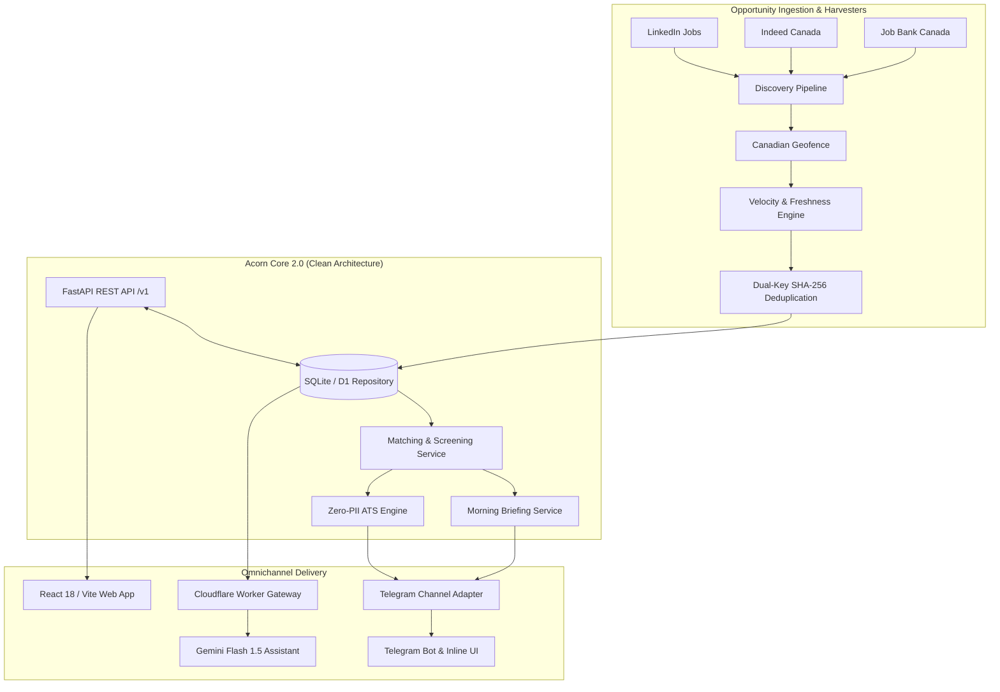

# 🌰 Acorn AI

[](https://github.com/mtk7zt/Acorn/actions/workflows/job_tracker.yml)
[](https://github.com/mtk7zt/Acorn/actions/workflows/acorn_product_ci.yml)
[](https://www.python.org/downloads/)
[](apps/web)
[](src/acorn/interfaces/api)
[](https://workers.cloudflare.com/)
[](https://deepmind.google/technologies/gemini/)
[](docs/PROJECTED_ARCHITECTURE_SPECIFICATION.md)
[](LICENSE)

> **Be first to what matters.**

Acorn is a Canadian-first career intelligence engine that keeps watch for relevant
tech opportunities, filters noise, prioritizes timing, and brings worthwhile roles
to the user instead of asking the user to spend the day refreshing job boards.

Acorn is built around two core product primitives:

- **Acorn Signal** — one qualified opportunity with a clear, evidence-based reason
  it deserves attention.
- **Acorn Briefing** — a small, curated set of Signals delivered when something is
  actually worth the user's time.

Acorn itself is personified as a living acorn career scout. Its mini-acorn **Scouts**
represent the background search system across web, mobile, and conversational surfaces.

---

## Product Status

**Acorn 2.0 (Evolution Release):** Omnichannel Personal Career Intelligence Engine.

The repository provides:

- **Modern Web Application (`apps/web/`)**: React 18, Vite 6, Tailwind CSS, animated Acorn Mascot and Scouts, interactive Fit Check prototype, Founder Access & Admin portal with Web Crypto single-use invitation hashing.
- **Acorn Core 2.0 Backend (`src/acorn/`)**: Multi-tenant Clean Architecture with pure domain models (`Tenant`, `User`, `Signal`, `ActivityEvent`), ACID SQLite persistence with WAL mode and dual-key SHA-256 fingerprint deduplication, and a decoupled FastAPI REST API (`/v1/*`).
- **Grounded ATS Intelligence**:
  - Memory-only Zero-PII redaction (emails, phones, SIN/SSN, LinkedIn, street addresses).
  - Trending 2026 tech stack competency parsing (FastAPI, Tailwind, Snowflake, Kafka, Datadog, Prometheus, etc.).
  - Human-sounding, quantified Google XYZ bullet points displaying genuine business impact (e.g. 99.9% uptime, 35% latency drop, 45+ daily tickets with 98% SLA, 40% cycle time reduction).
  - Systematic Job Description (JD) breakdown and resume gap analysis.
- **Omnichannel Telegram Bot & Edge Gateway (`cloudflare-worker/`)**:
  - Cloudflare Worker running Google Gemini Flash conversational intelligence with 50-message KV memory.
  - Interactive bot keyboard with `[👤 My Profile & Roles]`, `[🔍 Scan Target Roles]`, `[🎯 Check ATS Fit]`, `[📋 Breakdown JD]`, `[📄 Scan Resume]`, and `[🗑️ Wipe Data]`.
  - Edge `/api/v1/*` REST routes for D1-backed invitation keys, session authentication, and audit logs.
- **BETA-01 — Controlled Beta Tester Activation**:
  - 256-bit CSPRNG key generation (`ACRN-BETA-...`) stored as peppered HMAC-SHA256 digests.
  - Single-use and cohort capacity keys with atomic zero-oversubscription concurrency defense.
  - Central Authorization Guard (`FOUNDER`, `TESTER`, `PUBLIC`, `REVOKED`) and founder admin suite (`/admin`, `/newkey`, `/keys`, `/testers`, `/grant_access`, `/revoke_*`).
- **BETA-02 — Personalized Profiles, Scan Isolation & Data Portability**:
  - Canonical user identities (`acorn_user_id`), transport-independent Telegram identity bindings.
  - Isolated per-user profiles, target roles, and search preferences (`/profile`, `/setroles`, `/setlocations`, `/preferences`).
  - Strict user-owned scan dispatch and recipient binding: 100% notification isolation with zero cross-user leakage.
  - Reorganized non-sensitive operational files under `data/runtime/` with full deduplication history preserved.
  - Cloud-independent storage contracts (`IResumeStorage`) and versioned profile export/import (`acorn-profile` v1.0).
- **Automated Pipeline**: Scheduled GitHub Actions runner with Canadian GTA-first geofencing, freshness ranking, and saturation detection.
- **100% Passing Automated Tests**: **61 unit, integration, concurrency, and security tests** verifying domain models, persistence, geofence, velocity, security, user isolation, profile portability, and activation lifecycles.

---

## Product Principles

### Attention over volume
Acorn surfaces fewer, better opportunities rather than becoming an infinite, noisy job feed.

### Timing with provenance
Freshness, applicant counts, source evidence, and relevance are separate signals. Acorn never presents an inferred applicant count as a reported fact.

### Canada first
Strict priority for the Greater Toronto Area (GTA Priority 1), Outer GTA (Priority 2), and verified Canada-wide remote opportunities (Priority 3). Foreign and US-state postings are actively rejected.

### Privacy by design & data sovereignty
Resume and profile text is sanitized in-memory before keyword evaluation. Users retain full data sovereignty with one-click data wiping (`/forget` or `DELETE /v1/privacy/data`).

### Grounded impact with numerical quantification
ATS suggestions showcase tangible business value and realistic numerical metrics formatted via Google XYZ principles to pass modern ATS filters without fabricating candidate credentials.

---

## Core Capabilities

| Capability | Current Implementation | Longer-Term Roadmap |
| :--- | :--- | :--- |
| **Canadian Opportunity Qualification** | Active (GTA, Outer GTA, Canada Remote) | Expand regional coverage across Canadian provinces |
| **Role Filtering & Alignment** | Multi-role tracking with junior/senior overrides | Dynamic personalized goal models |
| **Signal Prioritization** | Tiered velocity ranking & applicant observation | Learned preference ranking |
| **Canonical Deduplication** | Dual-key SHA-256 fingerprinting + ACID repo | Cross-board entity resolution |
| **Acorn Signal & Briefing** | Implemented in domain, SQLite, and Web prototype | User-customized morning briefing schedule |
| **Telegram Bot Experience** | Live edge webhook with Gemini Flash controls | Telegram Mini-App (TMA) embedding |
| **Web Application** | Full React 18 / Vite 6 app in `apps/web/` | Production deployment to Cloudflare Pages |
| **ATS Resume & JD Engine** | Quantified XYZ statements + skill breakdown | Real-time interactive resume editor |
| **Living Mascot System** | SVG state-machine in `apps/web/` | Cross-platform Rive animations |
| **Native Mobile Apps** | Documented specifications in `docs/` | React Native / Flutter (iOS & Android) |

---

## System Architecture



---

## Repository Map

```text
.
├── apps/
│   └── web/                               # React 18 + Vite 6 frontend application
│       ├── src/
│       │   ├── components/
│       │   │   ├── auth/                  # Founder access & invitation management
│       │   │   ├── mascot/                # Living Acorn mascot & mini Scouts
│       │   │   ├── product/               # Hero, Briefings, Signals, Fit Check
│       │   │   └── ui/                    # Accessible UI primitives & design tokens
│       │   ├── services/                  # Web Crypto SHA-256, PII redactor, API client
│       │   └── pages/                     # Design system & prototype views
│       ├── package.json
│       └── vite.config.ts
├── cloudflare-worker/
│   ├── index.js                           # Edge Telegram webhook + Gemini conversational assistant
│   ├── api_v1_routes.js                   # D1 REST routes for invitations, sessions & signals
│   ├── wrangler.toml
│   └── package.json
├── docs/                                  # Complete product & architecture specifications
│   ├── BRAND_SYSTEM.md                    # Visual guidelines and palette
│   ├── MASCOT_SYSTEM.md                   # Character behavior, emotional states & audio cues
│   ├── PRODUCT_UX_SPEC.md                 # User journeys, signals, and briefings
│   ├── MOBILE_PRODUCT_SPEC.md             # Native iOS/Android specifications
│   ├── CROSS_PLATFORM_STRATEGY.md         # Multi-surface synchronization
│   └── PRIVACY_UX.md                      # Data sovereignty & client-side sanitization
├── migrations/                            # Cloudflare D1 database migrations
│   ├── 0001_acorn_production_auth_and_invites.sql
│   └── 0001_rollback.sql
├── src/acorn/
│   ├── application/
│   │   ├── services/                      # Ingestion, Matching, Briefing services
│   │   ├── config.py                      # Application settings
│   │   └── pipeline.py                    # Legacy discovery pipeline
│   ├── domain/
│   │   ├── identity.py                    # Tenant, User, UserPreferences, ChannelBinding
│   │   ├── signals.py                     # Signal, SignalStatus, MorningBriefing
│   │   ├── activity.py                    # ActivityEvent audit logging
│   │   ├── models.py                      # JobListing, ATSMatchResult, canonical fingerprint
│   │   ├── security.py                    # PII redactor, quantified XYZ engine, JD breakdown
│   │   ├── geofence.py                    # Canadian geographic qualification
│   │   └── velocity.py                    # Freshness ranking & saturation detection
│   ├── infrastructure/
│   │   ├── persistence/                   # SqliteAcornRepository (ACID SQLite repo)
│   │   ├── channels/                      # TelegramChannelAdapter
│   │   ├── notifiers/                     # Telegram 3-row interactive keyboards
│   │   ├── scrapers/                      # JobSpy, LinkedIn, JobBank adapters
│   │   └── storage/                       # Atomic JSON store
│   └── interfaces/
│       ├── api/                           # FastAPI v1 REST routes (/v1/*)
│       └── repository.py                  # Domain repository interfaces
├── tests/                                 # 37 comprehensive unit & integration tests
├── .github/workflows/
│   ├── acorn_product_ci.yml               # Path-filtered CI (web build, backend pytest, edge)
│   └── job_tracker.yml                    # Scheduled 10-minute discovery cron
├── requirements.txt                       # Python dependencies (FastAPI, pydantic, httpx, pytest)
├── job_tracker_bot.py                     # CLI entrypoint for discovery runs
└── web/                                   # Standalone preview landing page
```

---

## Getting Started

### Prerequisites

- Python 3.11+
- Node.js 20+ & npm
- Git

### 1. Python Engine Setup

```bash
# Clone the repository
git clone https://github.com/mtk7zt/Acorn.git
cd Acorn

# Create and activate virtual environment
python -m venv .venv

# Windows PowerShell:
.\.venv\Scripts\Activate.ps1
# macOS/Linux:
source .venv/bin/activate

# Install dependencies & run tests
pip install -r requirements.txt
python -m pytest tests/ -v
```

### 2. Web Application Setup

```bash
cd apps/web
npm install
npm test            # Run characterization tests
npm run dev         # Launch local development server (http://localhost:5173)
npm run build       # Build production bundle
```

### 3. FastAPI REST Server

```bash
# Run the Acorn Core 2.0 REST API locally
uvicorn src.acorn.interfaces.api.api:create_app --factory --reload --port 8000
```
Interactive OpenAPI documentation will be available at `http://127.0.0.1:8000/docs`.

### 4. Safe Local Discovery Test

Execute a job discovery harvest without dispatching Telegram alerts:

```bash
python job_tracker_bot.py --dry-run
```

---

## Cloudflare Edge Worker Deployment

The edge gateway powers both the Telegram assistant and the `/api/v1/*` REST endpoints:

```bash
cd cloudflare-worker
npm install
npx wrangler login

# Set required edge secrets:
npx wrangler secret put TELEGRAM_BOT_TOKEN
npx wrangler secret put TELEGRAM_SECRET_TOKEN
npx wrangler secret put GEMINI_API_KEY
npx wrangler secret put GITHUB_PAT
npx wrangler secret put ALLOWED_CHAT_IDS

# Deploy isolate to Cloudflare:
npx wrangler deploy
```

---

## License

This project is licensed under the MIT License — see the [LICENSE](LICENSE) file for details.
