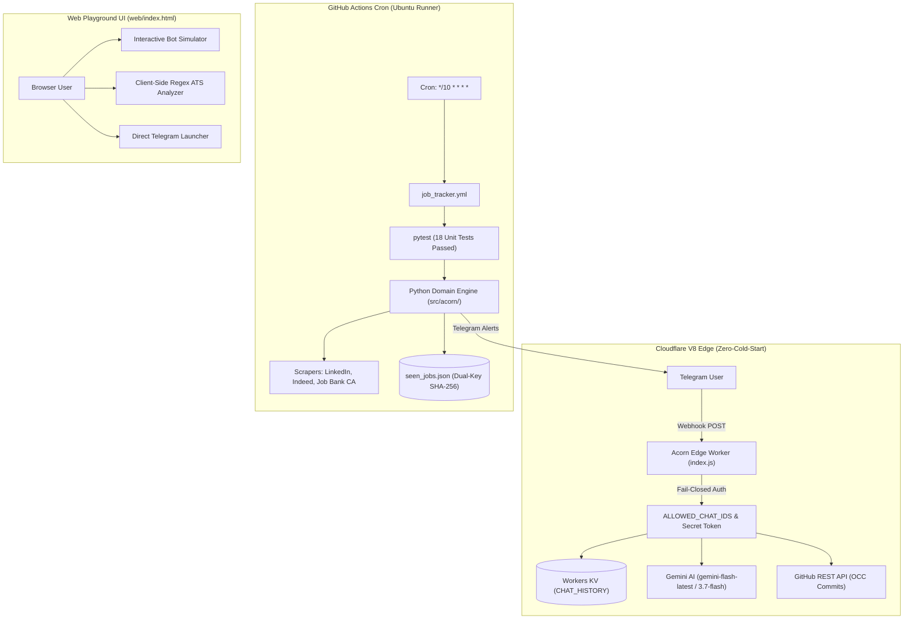
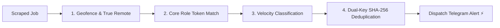

# 🌰 Acorn Complete Operational Guide & Ecosystem Reference

> **Autonomous Multi-Board Canadian Tech Job Tracker & Zero-PII Edge AI Co-Pilot**  
> *Targeted for High-Throughput Scraping, Sub-3s Edge Responses, and First-Mover Recruiter Visibility.*

---

## 📑 Table of Contents
1. [System Architecture Overview](#1-system-architecture-overview)
2. [Telegram Bot Command & Conversational Runbook](#2-telegram-bot-command--conversational-runbook)
3. [The 4 Mandatory Algorithmic Rules](#3-the-4-mandatory-algorithmic-rules)
4. [Zero-PII ATS Resume Co-Pilot Engine](#4-zero-pii-ats-resume-co-pilot-engine)
5. [Cloudflare Edge Worker & AI Architecture](#5-cloudflare-edge-worker--ai-architecture)
6. [Web Playground UI & Simulator](#6-web-playground-ui--simulator)
7. [GitHub Actions CI/CD & Issue/PR Workflow](#7-github-actions-cicd--issuepr-workflow)
8. [Infrastructure as Code (IaC) & Terraform](#8-infrastructure-as-code-iac--terraform)
9. [Operational Troubleshooting & Runbook](#9-operational-troubleshooting--runbook)

---

## 1. System Architecture Overview

Acorn is an enterprise dual-runtime distributed platform that bifurcates batch web scraping from conversational user interactions:



### Repository Structure
```
Acorn/
├── .github/
│   ├── workflows/
│   │   ├── deploy_worker.yml      # CI/CD Cloudflare Worker deployment
│   │   └── job_tracker.yml        # 24/7 Scheduled scraper & Pytest runner
│   ├── ISSUE_TEMPLATE/
│   │   ├── 01_bug_report.yml      # Structured bug report form
│   │   ├── 02_feature_request.yml # Feature proposal form
│   │   ├── 03_job_board_adapter.yml # Canadian scraper proposal form
│   │   └── config.yml             # Issue chooser configuration
│   └── PULL_REQUEST_TEMPLATE.md   # Standardized PR review checklist
├── cloudflare-worker/
│   ├── index.js                   # Edge API gateway, ATS evaluator, Gemini bridge
│   ├── package.json               # Wrangler & dependencies
│   └── wrangler.toml              # KV binding & compatibility flags
├── docs/
│   ├── ACORN_ARCHITECTURE_SPECIFICATION.md # Harvard-style design paper
│   ├── CURRENT_SYSTEM_SPECIFICATION.md     # Baseline architectural audit
│   ├── PROJECTED_ARCHITECTURE_SPECIFICATION.md # Target architecture spec
│   └── ACORN_COMPLETE_OPERATIONAL_GUIDE.md # This complete operations manual
├── src/acorn/
│   ├── application/               # Pipeline orchestrator & Config manager
│   ├── domain/                    # Filtering, Geofence, Velocity, Models, Security
│   ├── infrastructure/            # Scrapers (LinkedIn, Job Bank, JobSpy), JSON Store, Telegram
│   └── interfaces/                # Scraper, Storage, Notifier abstract protocols
├── terraform/                     # Declarative cloud provisioning (Worker + KV)
├── tests/                         # Pytest unit test suite (18 automated tests)
├── web/
│   └── index.html                 # Cross-functional UI Playground & Bot Hub
├── job_tracker_bot.py             # CLI entrypoint for batch scraping
├── pytest.ini                     # Pythonpath configuration
├── requirements.txt               # Locked dependencies
└── setup_webhook.py               # Webhook registration script
```

---

## 2. Telegram Bot Command & Conversational Runbook

The bot operates on a **zero-trust fail-closed model**. Only Telegram user IDs listed in `ALLOWED_CHAT_IDS` are granted access.

### Core Deterministic Commands (Edge Native)
These commands execute **100% locally on Cloudflare Worker** with sub-50ms response times, operating independently of Gemini status:

| Command | Action | Payload / Output |
| :--- | :--- | :--- |
| **`/start`** or **`/help`** | Displays bot overview & quick-action interactive keyboard | 4 Inline buttons: View Roles, Add Role, Check ATS, Wipe Data |
| **`/roles`** | Reads `roles_config.json` via GitHub REST API | Formatted numbered list of currently tracked positions |
| **`/ats`** | Arms ATS evaluation mode for the next 5 minutes | Requests resume text with explicit zero-PII guarantee |
| **`/scan`** | Triggers manual job scraping pipeline on GitHub Actions | Dispatches `workflow_dispatch` to `.github/workflows/job_tracker.yml` |
| **`/forget`** | Exercises candidate Data Sovereignty | Deletes conversation turns & cached ATS evaluations from edge KV |

### Natural Language Conversational Prompts
The bot routes free-form text to **Gemini Flash (gemini-flash-latest / 3.7-flash)** with automatic action execution:

- **Adding a Role:**  
  *User:* `Add Junior DevOps Engineer and Cloud Architect`  
  *Action:* Bot executes Optimistic Concurrency Control (OCC) commit to `roles_config.json` with `[skip ci]`.
- **Removing a Role:**  
  *User:* `Stop tracking QA Analyst`  
  *Action:* Bot removes role from repository and commits state.
- **Configuring Max Age:**  
  *User:* `Set max job age to 4 hours`  
  *Action:* Updates `bot_config.json` `max_age_seconds: 14400`.
- **Personality Mode:**  
  *User:* `Be more encouraging` or `Switch to professional tone`  
  *Action:* Persists tone setting in Workers KV under `personality:<chat_id>`.

---

## 3. The 4 Mandatory Algorithmic Rules

Every scraped job listing must strictly pass all 4 filtering layers before an alert is dispatched:



### Rule 1: Canadian Jurisdiction & True-Remote Geofencing
- **Priority 1 (Core GTA):** Toronto, North York, Scarborough, Etobicoke, Downtown.
- **Priority 2 (Outer GTA):** Mississauga, Brampton, Markham, Vaughan, Oakville, Richmond Hill, Burlington.
- **Priority 3 (True Remote):** Must be located in Canada (or remote in Canada) **AND** explicitly contain remote tokens (`remote`, `work from home`, `hybrid`).
- **Strict Blocklist:** Foreign countries (US, India, UK, etc.) and US state suffixes (e.g. `, CA` for California, `, NY`, `, TX`) are rejected.

### Rule 2: Strict Role-Title Token Alignment
- **Positive Domain Matching:** Job titles must match active tracked roles in `roles_config.json` OR match `CORE_ROLE_DOMAIN_TOKENS` (developer, software, engineer, backend, frontend, devops, data, cloud, fullstack).
- **False-Positive Suppression:** Automatically excludes non-tech titles: *Sales, Cashier, Receptionist, Driver, Warehouse, Associate, Shift Manager, Cleaner, Server*.
- **Seniority Logic:** Excludes Senior, Lead, Staff, Principal, VP, Director titles **unless** explicitly overridden by junior/entry-level tokens (e.g. *Junior, Intermediate, Associate, Entry*).

### Rule 3: First-Mover Applicant Velocity Tiers
- **⚡ Tier A (FIRST MOVER):** `< 5` applicants. Highest recruiter visibility window. Immediate top priority.
- **🟡 Tier B (EARLY WAVE):** `5 – 25` applicants. Standard priority alert.
- **🟠 Tier C (MATURING):** `26 – 40` applicants. Approaching saturation.
- **⛔ Saturated (SUPPRESSED):** `> 40` applicants OR marked as `Reposted`. Dropped immediately to prevent application fatigue.

### Rule 4: Dual-Key Canonical SHA-256 Deduplication
State persistence in `seen_jobs.json` enforces two distinct keys with a 7-day TTL:
1. **Primary Key:** Raw `job_id` from the source board.
2. **Canonical Hash Key:**  
   $$\text{Hash} = \text{SHA256}(\text{normalized\_company} \mid \text{normalized\_title} \mid \text{normalized\_city})[0:16]$$  
   `fp_<hash>` prevents cross-board duplicates (e.g. identical job posted on LinkedIn, Indeed, and Job Bank).

---

## 4. Zero-PII ATS Resume Co-Pilot Engine

To protect candidate confidentiality, resume evaluations conform to **NIST SP 800-53 Rev. 5** (Zero Retention of PII):

1. **In-Memory Sanitization (`redact_pii()`):**
   - Emails: `[REDACTED_EMAIL]`
   - Phone Numbers (North American formats): `[REDACTED_PHONE]`
   - Canadian Postal Codes (`A1A 1A1` / `A1A1A1`): `[REDACTED_POSTAL_CODE]`
   - Social Insurance Numbers: `[REDACTED_IDENTIFIER]`
   - LinkedIn Personal Profile URLs: `[REDACTED_LINKEDIN_URL]`
2. **Deterministic Tech Keyword Scoring:**
   - Evaluates against 40+ canonical Canadian IT tokens (*python, docker, aws, kubernetes, ci/cd, sql, react, etc.*).
   - Generates match score:  
     $$\text{Score} = \min\left(100, \text{round}\left(\frac{|\text{Matched}|}{|\text{Matched}| + |\text{Missing}|} \times 100\right)\right)$$
3. **Google XYZ-Formula Recommendations:**
   - Transforms missing keywords into impactful bullet points:  
     *"• Accomplished [X], as measured by [Y], by doing [Z]."*
4. **Data Sovereignty:**
   - Candidate resume text is evaluated strictly in transient V8 isolate RAM. No PII is written to Cloudflare KV or disk.

---

## 5. Cloudflare Edge Worker & AI Architecture

The Cloudflare Worker (`cloudflare-worker/index.js`) operates on edge isolates with zero cold starts.

### Active Secrets Checklist
Ensure the following write-only secrets are configured in Cloudflare:
```bash
npx wrangler secret put TELEGRAM_BOT_TOKEN     # Bot token from @BotFather
npx wrangler secret put TELEGRAM_SECRET_TOKEN  # Secret token for webhook authenticity
npx wrangler secret put GEMINI_API_KEY         # Google AI Studio API key
npx wrangler secret put GITHUB_PAT             # Personal Access Token with repo scope
npx wrangler secret put ALLOWED_CHAT_IDS       # Comma-separated authorized Telegram IDs
```

### Dynamic Multi-Model Failover
The Worker queries Google's `ListModels` API on startup and establishes a prioritized failover pipeline:
1. **`models/gemini-flash-latest`** — Primary stable auto-routing alias.
2. **`models/gemini-3.7-flash`** — High-availability Flash.
3. **`models/gemini-3.5-flash`** — Redundant fallback.
4. **`models/gemini-3.8-flash`** — Advanced reasoning.
5. **`models/gemini-flash-lite-latest`** — Ultra-low latency fallback.

*Note:* Every candidate request includes a strict 6-second timeout (`AbortSignal.timeout(6000)`), preventing Cloudflare `waitUntil()` timeouts during upstream Google API demand spikes.

---

## 6. Web Playground UI & Simulator

Located at [web/index.html](file:///C:/Users/esosa/Documents/antigravity/noble-carson/web/index.html), the Acorn Web Hub provides a full browser-based interface:

- **Interactive Bot Terminal:** Simulates mobile and desktop Telegram chat with inline keyboard buttons.
- **Client-Side Regex ATS Playground:** Live PII redaction demonstration and instant scoring.
- **1-Click Deep-Link Launcher:** Connects visitors directly to `https://t.me/<YourBotHandle>`.
- **Standalone Artifact:** Viewable directly inside the development workspace at [acorn_playground_ui.html](file:///C:/Users/esosa/.gemini/antigravity/brain/72d43d5a-6012-4577-89d1-392395073368/acorn_playground_ui.html).

---

## 7. GitHub Actions CI/CD & Issue/PR Workflow

### Automated CI/CD Pipeline
- **Job Scraping Cron (`.github/workflows/job_tracker.yml`):**
  - Triggers every 10 minutes (`*/10 * * * *`) or via `/scan` in Telegram.
  - Automatically runs `python -m pytest tests/ -v` with `PYTHONPATH: .`.
  - Scraping only runs if all 18 unit tests pass.
- **Worker Deployment (`.github/workflows/deploy_worker.yml`):**
  - Deploys `cloudflare-worker/` on every push to `main` via `cloudflare/wrangler-action`.

### Issue & Pull Request Workflow
1. **Submit Bug Reports or Requests:**
   - Use [GitHub Issues](https://github.com/mtk7zt/Acorn/issues) with our structured templates:
     - `🐛 Bug Report` (`01_bug_report.yml`)
     - `✨ Feature Request` (`02_feature_request.yml`)
     - `🍁 Job Board Adapter` (`03_job_board_adapter.yml`)
2. **Open Pull Requests:**
   - Create a feature branch: `git checkout -b feature/my-enhancement`
   - Test locally: `python -m pytest tests/ -v`
   - Push and open a PR: GitHub automatically loads [.github/PULL_REQUEST_TEMPLATE.md](file:///C:/Users/esosa/Documents/antigravity/noble-carson/.github/PULL_REQUEST_TEMPLATE.md) with our quality checklist.

---

## 8. Infrastructure as Code (IaC) & Terraform

Declarative infrastructure definitions are located in `terraform/`:
- `main.tf`: Cloudflare Worker script, KV namespace binding, and secret environment variables.
- `variables.tf`: Configurable inputs (`account_id`, `bot_token`, `allowed_chat_ids`).
- `outputs.tf`: Deployed Worker URL and KV namespace ID.

Deploy with Terraform:
```bash
cd terraform
cp terraform.tfvars.example terraform.tfvars
# Fill in your cloudflare credentials in terraform.tfvars
terraform init
terraform apply
```

---

## 9. Operational Troubleshooting & Runbook

### Issue A: Telegram Bot Not Responding
1. **Check Live Logs:**
   ```cmd
   cd cloudflare-worker
   npx wrangler tail
   ```
2. **Verify User Authorization:** Message `@userinfobot` on Telegram to get your numeric ID. Verify it exists in:
   ```cmd
   npx wrangler secret put ALLOWED_CHAT_IDS
   ```
3. **Verify Webhook:** Confirm webhook URL and secret token via PowerShell:
   ```powershell
   Invoke-RestMethod "https://api.telegram.org/bot$BOT_TOKEN/getWebhookInfo"
   ```

### Issue B: Gemini API Returns 402 or 503
- **HTTP 402 (Prepayment Depleted):** Visit [Google AI Studio](https://aistudio.google.com/apikey) and create an API key in a brand new project without billing attached for 15 free req/min. Update via `npx wrangler secret put GEMINI_API_KEY`.
- **HTTP 503 (High Demand Spike):** The Worker's automated failover engine will automatically route to `gemini-3.7-flash` or `gemini-3.5-flash`. Core bot commands (`/start`, `/roles`, `/ats`, `/scan`, `/forget`) remain 100% operational regardless of Google API status.

### Issue C: GitHub Actions Scraping Fails on Tests
Ensure [pytest.ini](file:///C:/Users/esosa/Documents/antigravity/noble-carson/pytest.ini) is present in the repository root containing:
```ini
[pytest]
pythonpath = .
```
Verify locally:
```bash
python -m pytest tests/ -v
```
All 18 tests must pass.
