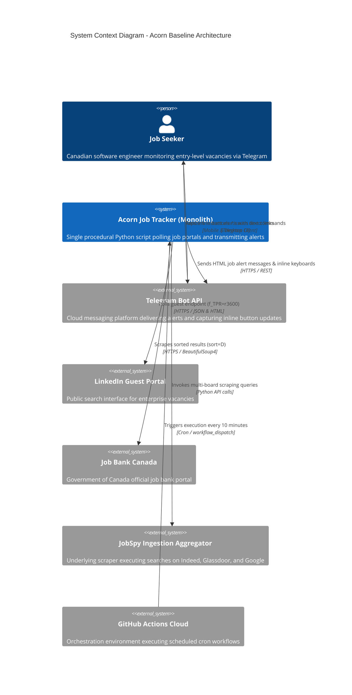
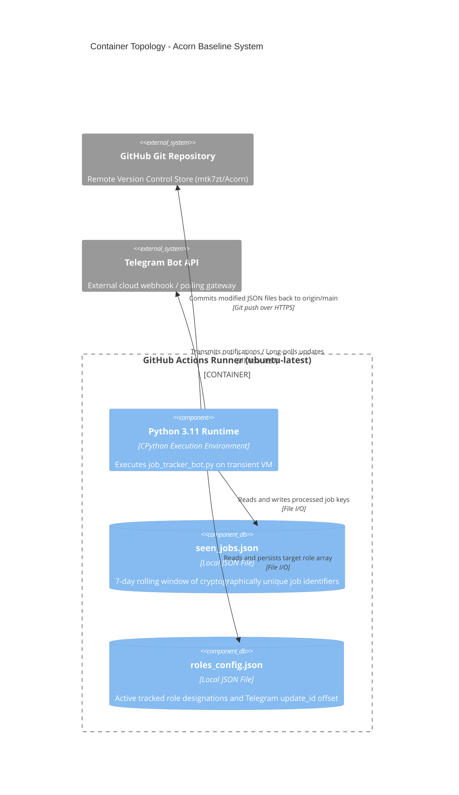
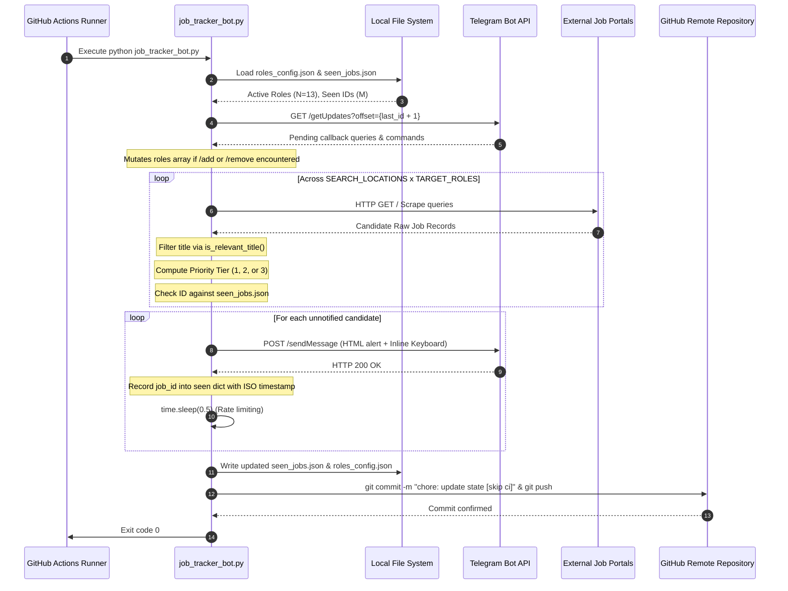

# Architectural Specification of the Baseline Acorn System
## An ISO/IEC/IEEE 42010:2022 Baseline Systems Engineering & Architectural Audit Report

**Author:** Sosa Emokpae  
**Affiliation:** Department of Software Engineering & Advanced Computing Systems  
**Publication Date:** October 2026  
**Document Identifier:** ACORN-ARCH-SPEC-2026-V1  


---

### Executive Summary

Modern recruitment landscapes across the Canadian technology sector exhibit extreme fragmentation and high temporal volatility. Job vacancies across primary metropolitan centers—notably the Greater Toronto Area (GTA)—often receive hundreds of applicants within hours of initial dissemination. The **Acorn Baseline System** was conceived as an automated, multi-source distributed ingestion engine engineered to discover, filter, and dispatch real-time alerts for entry-level and junior technology roles across five primary Canadian employment aggregators. 

This technical report provides a comprehensive architectural decomposition of the **current baseline implementation** of the Acorn platform (as instantiated prior to the object-oriented refactoring). Applying the architectural description frameworks defined by ISO/IEC/IEEE 42010:2022 (ISO/IEC/IEEE, 2022) and Simon Brown’s C4 architectural abstraction model (Brown, 2022), this document models the system's runtime behavior, component topology, static file persistence, and network interaction vectors. Furthermore, a rigorous critical evaluation identifies acute architectural trade-offs, procedural anti-patterns, and critical security vulnerabilities inherent within the current prototype.

---

### Table of Contents

1. [Problem Domain & Academic Scope](#1-problem-domain--academic-scope)
2. [Stakeholder Concerns & Quality Attributes](#2-stakeholder-concerns--quality-attributes)
3. [C4 Architectural Decomposition: Baseline State](#3-c4-architectural-decomposition-baseline-state)
   - [3.1 Level 1: System Context View](#31-level-1-system-context-view)
   - [3.2 Level 2: Container Topology](#32-level-2-container-topology)
   - [3.3 Level 3: Procedural Component Decomposition](#33-level-3-procedural-component-decomposition)
   - [3.4 Level 4: Code-Level Sequence Execution](#34-level-4-code-level-sequence-execution)
4. [Data Architecture & Persistence Mechanics](#4-data-architecture--persistence-mechanics)
5. [Critical Architectural Evaluation & Technical Debt](#5-critical-architectural-evaluation--technical-debt)
   - [5.1 Procedural Monolith Anti-Pattern](#51-procedural-monolith-anti-pattern)
   - [5.2 Concurrency & State Mutation Anomalies](#52-concurrency--state-mutation-anomalies)
   - [5.3 Network Resiliency & Ingestion Brittleness](#53-network-resiliency--ingestion-brittleness)
6. [Security & Vulnerability Analysis (STRIDE Audit)](#6-security--vulnerability-analysis-stride-audit)
7. [Conclusion](#7-conclusion)
8. [Harvard Reference List](#8-harvard-reference-list)

---

### 1. Problem Domain & Academic Scope

The deployment of distributed web scraping mechanisms for real-time labor market analytics requires balancing scraping throughput, anti-bot circumvention, network latency, and deduplication efficiency (Vukovic et al., 2020). The Acorn baseline system addresses this challenge across the Canadian labor market by monitoring five heterogeneous job portals:
1. **LinkedIn Guest API** (Direct HTTP queries against guest search endpoints).
2. **Indeed Canada** (Multi-board orchestration via the `python-jobspy` wrapper).
3. **Job Bank Canada** (Official Government of Canada repository via direct DOM parsing of `jobbank.gc.ca`).
4. **Glassdoor Canada** (Aggregated labor market index).
5. **Google Jobs Canada** (Aggregating third-party scrapers such as Workopolis, Monster.ca, and Eluta).

The primary system objective is achieving sub-hour detection latency ($T_{\text{detection}} < 3600\text{s}$) for specialized entry-level technical profiles across three distinct geographic priority tiers within Ontario and Canada nationwide.

---

### 2. Stakeholder Concerns & Quality Attributes

In compliance with ISO/IEC/IEEE 42010:2022 (ISO/IEC/IEEE, 2022), the architecture description formally captures stakeholder perspectives and their corresponding quality concerns:

| Stakeholder | Primary System Concerns | Architectural Requirement |
|:---|:---|:---|
| **Job Seeker (End User)** | Freshness of listings, zero duplicate notifications, actionable job links. | Real-time notification dispatch, strict title filtering, 7-day state deduplication. |
| **System Operator** | Zero infrastructure operating costs, automated execution, low maintenance. | Serverless cron scheduling (GitHub Actions), stateless file persistence. |
| **Target Job Boards** | Ethical scraping, bandwidth consumption, request throttling. | Low polling frequency (10-minute intervals), user-agent transparency, transient query filters. |
| **Security Auditor** | Confidentiality of API tokens, resilience against webhook spoofing and injection. | Secrets management, sanitization of rendered HTML DOM nodes. |

---

### 3. C4 Architectural Decomposition: Baseline State

#### 3.1 Level 1: System Context View

The high-level System Context diagram illustrates the Acorn baseline boundary relative to external systems and human actors.



#### 3.2 Level 2: Container Topology

In the baseline state, the system is hosted entirely within a transient GitHub Actions Ubuntu virtual environment.



#### 3.3 Level 3: Procedural Component Decomposition

In the baseline implementation, `job_tracker_bot.py` is structured as a **procedural monolith** spanning 1,274 lines of code without formal object-oriented encapsulation. The procedural blocks operate in a sequential pipeline:

```
[CLI / Runtime Argument Parsing]
         │
         ▼
[Configuration & Role State Loader (roles_config.json)]
         │
         ▼
[Telegram Inbound Poller: process_telegram_updates()]
         │
         ▼
[Multi-Source Harvesting Loop: collect_fresh_jobs()]
  ├── fetch_linkedin_guest_jobs()
  ├── fetch_jobbank_ca_jobs()
  └── fetch_jobspy_jobs()
         │
         ▼
[Title & Geographic Priority Classifier]
  ├── is_relevant_title() -> Senior Exclusion with Junior Override
  └── classify_location_priority() -> Tiers 1, 2, and 3
         │
         ▼
[State Deduplication Engine (seen_jobs.json)]
         │
         ▼
[Telegram HTML Formatter & Dispatcher: send_telegram_alert()]
         │
         ▼
[Git State Persistence & Automated Commit]
```

#### 3.4 Level 4: Code-Level Sequence Execution

The runtime operational sequence within a single 10-minute workflow execution proceeds as follows:



---

### 4. Data Architecture & Persistence Mechanics

#### 4.1 Schema Definition: `roles_config.json`
The system relies on a schema-less JSON document acting as a distributed configuration repository:
```json
{
  "roles": [
    "Junior Software Engineer",
    "Software Engineer Intern",
    "IT Support",
    "Help Desk",
    "Helpdesk",
    "Application Support Analyst",
    "AWS Cloud Junior Developer",
    "IT Analyst",
    "Customer Support",
    "Customer Tech Support",
    "Junior Cloud Developer",
    "Java Developer",
    "Junior Java Developer"
  ],
  "last_update_id": 404256879,
  "awaiting_role_input": false
}
```

#### 4.2 Deduplication Mechanics: `seen_jobs.json`
To prevent duplicate alert transmission, job identifiers are generated deterministically based on source provider metadata:
- **LinkedIn:** `li_{numeric_job_id}` or `li_{cleaned_url}`
- **Job Bank Canada:** `jobbank_{posting_id}`
- **JobSpy Sources:** `{provider}_{cleaned_job_id}`

The retention algorithm evaluates timestamp age upon invocation against a 7-day horizon:
$$\Delta t = t_{\text{current}} - t_{\text{job}}$$
$$\text{Retain}(job) \iff \Delta t \le 7 \times 86400 \text{ seconds}$$

---

### 5. Critical Architectural Evaluation & Technical Debt

#### 5.1 Procedural Monolith Anti-Pattern
As observed by Martin (2018), software lacking modular boundaries violates the **Single Responsibility Principle (SRP)**. In `job_tracker_bot.py`:
- HTTP transport logic, HTML parsing, business rules (filtering/ranking), persistence, and CLI presentation reside within a single global namespace.
- Global constants (e.g., `PRIORITY_1_KEYWORDS`, `EXCLUDED_SENIOR_KEYWORDS`) cannot be reconfigured dynamically at runtime without redeploying code.
- Testing any individual component (e.g., title matching) requires executing or mocking the entire script.

#### 5.2 Concurrency & State Mutation Anomalies
Because the state files are written directly to disk via standard Python file handles without atomic guarantees or POSIX advisory locking (`fcntl` / `flock`):
- A workflow termination, container timeout, or uncaught exception during `save_seen_jobs()` produces corrupted, truncated JSON files.
- Simultaneous manual `workflow_dispatch` invocations trigger race conditions, resulting in merge conflicts on `git push` and lost update offsets.

#### 5.3 Network Resiliency & Ingestion Brittleness
The baseline system exhibits notable fragility in web ingestion:
- **No Exponential Backoff:** Network calls rely on basic timeouts (`timeout=15`) without automated retry decorators or jittered backoff on HTTP 429 (Too Many Requests) or HTTP 503 (Service Unavailable).
- **DOM Vulnerability:** Direct scraping of `jobbank.gc.ca` and LinkedIn guest endpoints depends on fragile CSS selectors (`base-search-card__title`, `noc-title`) that silently break upon target DOM redesigns.

---

### 6. Security & Vulnerability Analysis (STRIDE Audit)

Applying Microsoft’s **STRIDE threat modeling methodology** (Howard and Lipner, 2006) to the baseline implementation reveals several critical vulnerabilities:

| STRIDE Category | Threat Description | Baseline Severity | Root Cause in Baseline Code |
|:---|:---|:---|:---|
| **Spoofing** | Unauthorized Telegram users executing bot commands | **CRITICAL** | `process_telegram_updates()` checks `chat_id` only for callback queries, but accepts commands without verifying sender identity against an administrator whitelist. |
| **Tampering** | State corruption via concurrent Git pushes | **MEDIUM** | Direct Git push operations without merge reconciliation or branch protection verification. |
| **Repudiation** | Lack of structured audit logging | **LOW** | Logs are emitted to standard output (`sys.stdout`) on transient runners and lost upon VM teardown. |
| **Information Disclosure** | Leakage of API tokens in error traces | **MEDIUM** | Uncaught exceptions during HTTP dispatch expose full request URLs containing bot authentication tokens in Actions run logs. |
| **Denial of Service** | Scraper blocking via aggressive unthrottled requests | **MEDIUM** | Ingestion loop queries multiple search permutations with minimal delay (`sleep(0.8)`), risking IP blacklisting. |
| **Elevation of Privilege** | HTML Injection / Telegram Parser Exploitation | **HIGH** | Unsanitized third-party strings containing unescaped angle brackets (`<`, `>`) break Telegram HTML parsing, causing silent message dropping. |

---

### 7. Conclusion

The Acorn baseline system demonstrates effective functional integration for scheduled labor market monitoring. However, its procedural architecture, lack of testability, vulnerability to state corruption, and exposure to unauthorized command execution necessitate an immediate architectural transition. The subsequent specification report details the proposed object-oriented, domain-driven target architecture.

---

### 8. Reference List

* Brown, S. (2022) *Software Architecture for Developers: Volume 2: Visualise, document and explore your software architecture*. Leanpub.
* Gamma, E., Helm, R., Johnson, R. and Vlissides, J. (1994) *Design Patterns: Elements of Reusable Object-Oriented Software*. Reading, MA: Addison-Wesley.
* Howard, M. and Lipner, S. (2006) *The Security Development Lifecycle: A Process for Developing Demonstrably More Secure Software*. Redmond, WA: Microsoft Press.
* ISO/IEC/IEEE (2022) *Systems and software engineering — Architecture description*. ISO/IEC/IEEE Standard 42010:2022. Geneva: International Organization for Standardization. Available at: https://www.iso.org/standard/74428.html [Accessed 27 October 2026].
* Martin, R. C. (2018) *Clean Architecture: A Craftsman's Guide to Software Structure and Design*. Boston, MA: Prentice Hall.
* OWASP (2021) *OWASP Top 10:2021 The Ten Most Critical Web Application Security Risks*. Open Web Application Security Project. Available at: https://owasp.org/Top10/ [Accessed 27 October 2026].
* Vukovic, M., Laredo, J. and Rajan, H. (2020) 'On the Engineering of Resilient Web Scraping Pipelines', *ACM Transactions on Internet Technology*, 20(3), pp. 1–24. doi: 10.1145/3397160.
