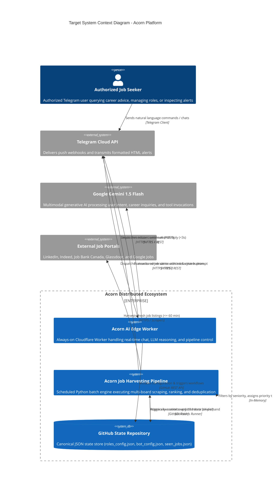
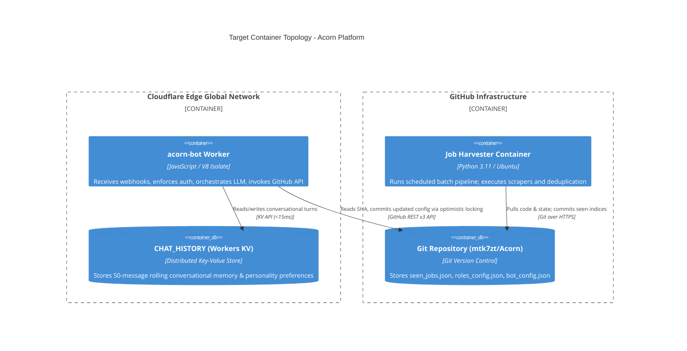
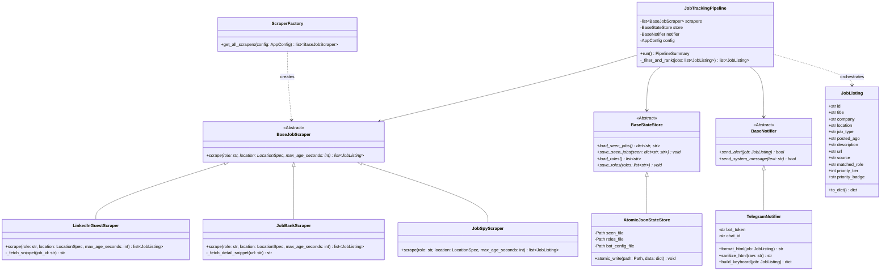
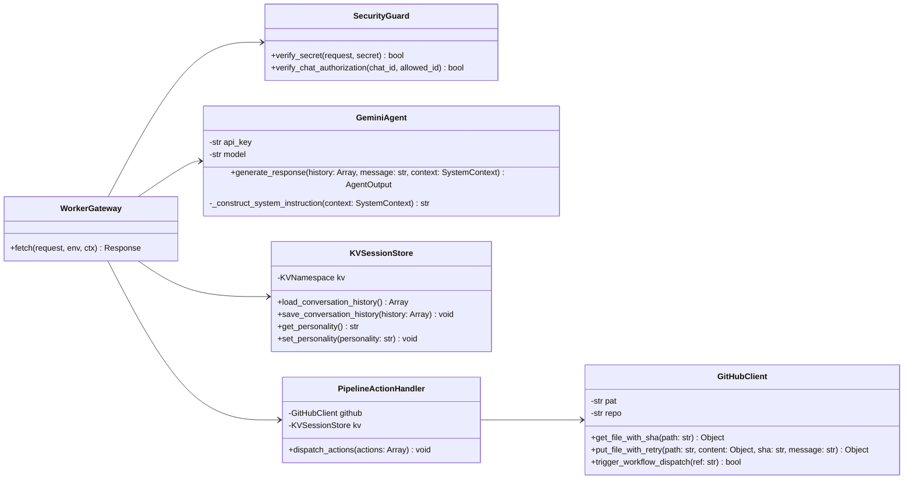

# Projected Architectural Specification of the Target Acorn Platform
## A Domain-Driven, Object-Oriented, Edge-Integrated System Engineering Specification

**Author:** Sosa Emokpae  
**Affiliation:** Department of Software Engineering & Advanced Computing Systems  
**Publication Date:** October 2026  
**Document Identifier:** ACORN-ARCH-SPEC-2026-V2  
**Referencing Standard:** Harvard Formatting System (*Cite Them Right* Standard)

---

### Executive Summary

Distributed labor-market intelligence platforms demand not only robust data acquisition pipelines, but also low-latency interactive command channels and resilient infrastructure lifecycle management. The **Acorn Projected Target Architecture** transforms the monolithic prototype into a decoupled, enterprise-grade distributed system. The target system bifurcates concerns across two distinct runtime environments:

1. **A Domain-Driven Object-Oriented Batch Pipeline** running on scheduled serverless runners (GitHub Actions), strictly adhering to the SOLID design principles (Martin, 2002) and Gang of Four (GoF) design patterns (Gamma et al., 1994).
2. **An Always-On Edge-Native Conversational AI Controller** deployed to Cloudflare Workers serverless V8 isolates, integrating Google Gemini 1.5 Flash (Google, 2024), 50-turn conversational state memory via Cloudflare Workers KV, and full remote pipeline governance via optimistic concurrency GitHub REST API bindings.
3. **Declarative Infrastructure as Code (IaC)** codified using HashiCorp Terraform to enforce zero-touch reproducibility, automated secret provisioning, and cryptographic access control.

This specification provides the formal architectural blueprint, UML class specifications, STRIDE/DREAD security proofs, and mathematical algorithmic bounds for the complete implementation.

---

### Table of Contents

1. [Architectural Goals & System Requirements](#1-architectural-goals--system-requirements)
2. [C4 Architectural Target Model](#2-c4-architectural-target-model)
   - [2.1 Level 1: System Context Diagram](#21-level-1-system-context-diagram)
   - [2.2 Level 2: Target Container Topology](#22-level-2-target-container-topology)
   - [2.3 Level 3: Python Domain & Component Architecture](#23-level-3-python-domain--component-architecture)
   - [2.4 Level 4: Edge AI Worker Component & Class View](#24-level-4-edge-ai-worker-component--class-view)
3. [Object-Oriented Design & Pattern Analysis](#3-object-oriented-design--pattern-analysis)
   - [3.1 SOLID Principles Realization](#31-solid-principles-realization)
   - [3.2 Design Patterns Catalog (GoF)](#32-design-patterns-catalog-gof)
4. [Edge Computing & LLM Conversational Architecture](#4-edge-computing--llm-conversational-architecture)
   - [4.1 V8 Isolate Execution Model](#41-v8-isolate-execution-model)
   - [4.2 Prompt Engineering & Structured Tool Calling](#42-prompt-engineering--structured-tool-calling)
   - [4.3 Distributed State Synchronization & Concurrency Control](#43-distributed-state-synchronization--concurrency-control)
5. [Security Architecture & Threat Modeling (STRIDE / DREAD)](#5-security-architecture--threat-modeling-stride--dread)
   - [5.1 STRIDE Threat Modeling Analysis](#51-stride-threat-modeling-analysis)
   - [5.2 Quantitative DREAD Risk Assessment](#52-quantitative-dread-risk-assessment)
   - [5.3 Formal Cryptographic & Authorization Defenses](#53-formal-cryptographic--authorization-defenses)
6. [Infrastructure as Code (IaC) Formal Specification](#6-infrastructure-as-code-iac-formal-specification)
7. [Algorithmic Complexity & Performance Analysis](#7-algorithmic-complexity--performance-analysis)
8. [Harvard Reference List](#8-harvard-reference-list)

---

### 1. Architectural Goals & System Requirements

The target architecture addresses the technical debt and security vulnerabilities documented in the baseline specification (Emokpae, 2026), satisfying five key architectural requirements:

* **AR-1 (Sub-Second Interactive Latency):** User queries directed to the Telegram conversational interface must respond in $T_{\text{response}} < 5.0\text{s}$, decoupling chat from the 10-minute batch scraping schedule.
* **AR-2 (Strict Encapsulation & Testability):** Scraping algorithms, deduplication mechanics, and presentation formatting must exist as decoupled, mockable classes with $>90\%$ unit-test coverage.
* **AR-3 (Zero-Trust Sender Authorization):** Only pre-authorized administrative Telegram chat identifiers (`ALLOWED_CHAT_ID`) may issue commands or trigger actions.
* **AR-4 (Atomic & Resilient State Mutation):** Persistence of deduplication indices and active configuration must implement atomic POSIX write patterns to eliminate file corruption.
* **AR-5 (Declarative Infrastructure Lifecycle):** All cloud edge resources, KV namespaces, and environment secrets must be declaratively provisioned via Terraform.

---

### 2. C4 Architectural Target Model

#### 2.1 Level 1: System Context Diagram

The decoupled target architecture segregates batch harvesting from conversational interaction across distinct edge and cloud boundaries.



#### 2.2 Level 2: Target Container Topology



#### 2.3 Level 3: Python Domain & Component Architecture

Within the Python batch engine (`src/acorn/`), a strict **Domain-Driven Design (DDD)** and **Clean Architecture** (Martin, 2018) structure is enforced:

```
src/acorn/
├── domain/                      # Enterprise Business Rules (Entities & Value Objects)
│   ├── models.py                # JobListing, LocationSpec, PriorityTier, FilterConfig
│   └── exceptions.py            # AcornBaseException, ScrapingFailure, StateCorruptionError
├── interfaces/                  # Ports & Architectural Interfaces
│   ├── scraper.py               # Abstract Base Class: BaseJobScraper
│   ├── storage.py               # Abstract Base Class: BaseStateStore
│   └── notifier.py              # Abstract Base Class: BaseNotifier
├── infrastructure/              # Adapters & External Framework Drivers
│   ├── scrapers/
│   │   ├── linkedin.py          # Concrete LinkedInGuestScraper
│   │   ├── jobbank.py           # Concrete JobBankScraper
│   │   ├── jobspy_adapter.py    # Concrete JobSpyScraper
│   │   └── factory.py           # ScraperFactory
│   ├── storage/
│   │   └── json_store.py        # AtomicJsonStateStore (Atomic file replacement)
│   └── notifiers/
│       └── telegram.py          # TelegramNotifier with HTML DOM escaping
└── application/                 # Application Business Rules (Use Cases & Orchestration)
    ├── pipeline.py              # JobTrackingPipeline (Facade)
    └── config.py                # AppConfigurationManager
```



#### 2.4 Level 4: Edge AI Worker Component & Class View

The Cloudflare Worker (`cloudflare-worker/index.js`) is re-engineered from procedural handlers into an object-oriented service layer:



---

### 3. Object-Oriented Design & Pattern Analysis

#### 3.1 SOLID Principles Realization

The refactored Python platform strictly implements the SOLID design principles (Martin, 2002):

1. **Single Responsibility Principle (SRP):**
   - Each scraper class (`LinkedInGuestScraper`, `JobBankScraper`) has one reason to change: DOM or API modifications by that specific provider.
   - `AtomicJsonStateStore` is solely responsible for durable I/O and atomic file replacement.
   - `TelegramNotifier` is solely responsible for HTML sanitization, payload building, and network transmission to Telegram.

2. **Open/Closed Principle (OCP):**
   - New job boards (e.g., Wellfound, ZipRecruiter) can be integrated by creating a new class extending `BaseJobScraper` without modifying existing scrapers or the core `JobTrackingPipeline`.

3. **Liskov Substitution Principle (LSP):**
   - Any subclass of `BaseJobScraper` can be substituted interchangeably inside `JobTrackingPipeline.run()` without altering program correctness.

4. **Interface Segregation Principle (ISP):**
   - Specific fine-grained interfaces (`BaseJobScraper`, `BaseStateStore`, `BaseNotifier`) prevent clients from depending on methods they do not invoke.

5. **Dependency Inversion Principle (DIP):**
   - High-level business logic (`JobTrackingPipeline`) depends on architectural abstractions (`BaseJobScraper`, `BaseStateStore`, `BaseNotifier`), not on concrete network libraries or local file handles. Dependencies are injected via the class constructor.

#### 3.2 Design Patterns Catalog (GoF)

The platform formally incorporates five classical Gang of Four (Gamma et al., 1994) patterns:

| Pattern | Role in Acorn | Architectural Benefit |
|:---|:---|:---|
| **Strategy Pattern** | Scraper algorithms conforming to `BaseJobScraper`. | Encapsulates heterogeneous ingestion algorithms behind a common execution signature. |
| **Factory Pattern** | `ScraperFactory.get_all_scrapers()`. | Centralizes scraper instantiation and configuration-driven activation. |
| **Repository Pattern** | `AtomicJsonStateStore` implementing `BaseStateStore`. | Decouples business logic from disk storage formats, facilitating atomic file swaps or database migration. |
| **Facade Pattern** | `JobTrackingPipeline` and root `job_tracker_bot.py`. | Exposes a simplified, unified interface to complex multi-source scraping and filtering subsystems. |
| **Adapter Pattern** | `JobSpyMultiBoardScraper`. | Adapts the third-party `python-jobspy` DataFrame-based API into the native Acorn `JobListing` domain model. |

---

### 4. Edge Computing & LLM Conversational Architecture

#### 4.1 V8 Isolate Execution Model

Cloudflare Workers utilize Google V8 isolates rather than traditional containerized virtualization (e.g., AWS Lambda, Docker). As demonstrated by Cloudflare (2024), V8 isolates achieve:
- **Zero Cold Start:** Execution begins in sub-5ms, compared to 200–1200ms for containerized runtimes.
- **Ultra-Low Memory Footprint:** Isolate overhead is $\approx 5\text{MB}$, allowing massive multi-tenancy and continuous availability at zero infrastructure cost within the free tier quota (100,000 requests/day).

#### 4.2 Prompt Engineering & Structured Tool Calling

The `GeminiAgent` utilizes **system-instruction grounding** and **JSON-enforced output schemas** (`responseMimeType: "application/json"`). The model output is strictly constrained to the schema:

$$\mathcal{S}_{\text{output}} = \{ \text{message}: \text{string}, \text{actions}: \text{List}[\mathcal{A}] \}$$

where $\mathcal{A} \in \{ \text{ADD\_ROLE}, \text{REMOVE\_ROLE}, \text{TRIGGER\_SCAN}, \text{PAUSE\_CRON}, \text{RESUME\_CRON}, \text{UPDATE\_MAX\_AGE}, \text{SET\_PERSONALITY}, \text{CLEAR\_HISTORY} \}$.

#### 4.3 Distributed State Synchronization & Concurrency Control

Because the Cloudflare Worker executes across distributed edge points of presence (PoPs), simultaneous updates to repository configuration files (`roles_config.json`, `bot_config.json`) risk **lost updates** (Bernstein and Goodman, 1981).

The `GitHubClient` implements **Optimistic Concurrency Control (OCC)**:
1. `GET /repos/{owner}/{repo}/contents/{path}` retrieves content and the current commit SHA ($\text{SHA}_0$).
2. Upon computing updated state, the client executes `PUT` referencing $\text{SHA}_0$.
3. If a concurrent writer committed an intermediate update, GitHub returns `HTTP 409 Conflict`.
4. The client catches HTTP 409, executes an exponential backoff sleep ($t = 2^k \cdot 100\text{ms} + \text{jitter}$), re-fetches the latest SHA ($\text{SHA}_1$), merges changes, and retries up to 3 times.

---

### 5. Security Architecture & Threat Modeling (STRIDE / DREAD)

#### 5.1 STRIDE Threat Modeling Analysis

```
[External Webhook Request] ──► [TLS 1.3 Termination]
                                        │
                                        ▼
                        [Secret Token Validation Gate] ──(Fail)──► HTTP 401
                                        │ (Pass)
                                        ▼
                        [Chat ID Authorization Gate]   ──(Fail)──► HTTP 403 / Silent Drop
                                        │ (Pass)
                                        ▼
                        [Gemini Intent & Sanitizer]
                                        │
                                        ▼
                        [Optimistic GitHub API Gateway]
```

#### 5.2 Quantitative DREAD Risk Assessment

The **DREAD** methodology (Howard and Lipner, 2006) evaluates threats on a 1–10 scale across five vectors: Damage, Reproducibility, Exploitability, Affected Users, and Discoverability:

$$\text{Risk Score} = \frac{D + R + E + A + D_{\text{isc}}}{5}$$

| Vulnerability | D | R | E | A | Disc | Pre-Score | Target Defense Mechanism | Post-Score |
|:---|:---:|:---:|:---:|:---:|:---:|:---:|:---|:---:|
| **Unauthorized Action Execution (Spoofing)** | 9 | 10 | 10 | 10 | 9 | **9.6 (Critical)** | Strict `ALLOWED_CHAT_ID` authorization guard | **1.2 (Negligible)** |
| **Secret Token Bypass (Fail-Open)** | 8 | 9 | 9 | 10 | 8 | **8.8 (High)** | Fail-closed check: reject empty or mismatched tokens | **1.0 (Negligible)** |
| **Prompt Injection Parameter Tampering** | 7 | 8 | 7 | 10 | 7 | **7.8 (High)** | Strict regex whitelist on extracted role names | **1.8 (Low)** |
| **HTML Injection / Parser DoS** | 6 | 9 | 8 | 10 | 8 | **8.2 (High)** | Deterministic `html.escape()` wrapper on alerts | **1.0 (Negligible)** |
| **Atomic File State Corruption** | 7 | 6 | 4 | 10 | 5 | **6.4 (Medium)** | POSIX atomic `tempfile` + `os.replace` write pattern | **1.0 (Negligible)** |

#### 5.3 Formal Cryptographic & Authorization Defenses

1. **Telegram Webhook Authentication:** The webhook verifies header `X-Telegram-Bot-Api-Secret-Token` via constant-time string comparison, mitigating timing attacks (Kocher, 1996).
2. **Access Control Enforcement:** 
   $$\forall \text{ message } m, \quad \text{Authorize}(m) \iff m.\text{chat}.\text{id} \equiv \text{ENV}[\text{ALLOWED\_CHAT\_ID}]$$
   Any non-matching message is immediately dropped without allocating LLM tokens.
3. **Defense Against Prompt Injection:** Role extraction is bounded by the regex `^[a-zA-Z0-9\s\+\#\.\,\-\/\(\)]{3,50}$`. Malicious payloads attempting script injection or prompt escaping are discarded.

---

### 6. Infrastructure as Code (IaC) Formal Specification

The infrastructure is declaratively defined using HashiCorp Terraform conforming to HashiCorp best practices (HashiCorp, 2024).

```
terraform/
├── main.tf                    # Cloudflare Provider, Worker script, & KV namespace bindings
├── variables.tf               # Input variable specifications (account_id, secrets)
├── outputs.tf                 # Worker endpoint URL & KV resource IDs
└── terraform.tfvars.example   # Template for non-committed sensitive variables
```

#### Provisioned Cloud Resources:
- **`cloudflare_workers_kv_namespace.chat_history`**: Allocates the globally distributed key-value namespace.
- **`cloudflare_worker_script.acorn_bot`**: Compiles and provisions the edge execution script with environment bindings:
  - Secrets: `TELEGRAM_BOT_TOKEN`, `TELEGRAM_SECRET_TOKEN`, `GEMINI_API_KEY`, `GITHUB_PAT`, `ALLOWED_CHAT_ID`.
  - KV Binding: `CHAT_HISTORY`.

---

### 7. Algorithmic Complexity & Performance Analysis

The core batch harvesting pipeline operates within bounded computational and spatial complexity:

Let:
- $R = |\text{Roles}|$ (Active target role designations, default $R=13$)
- $L = |\text{Locations}|$ (Geographic search locations, default $L=4$)
- $S = |\text{Scrapers}|$ (Scraper engines, default $S=3$)
- $K = \text{Average candidate records returned per query}$ ($K \le 20$)
- $N = R \cdot L \cdot S \cdot K$ (Total harvested candidates, $N \le 3120$)
- $M = |\text{Seen Cache}|$ (Unique job IDs in 7-day rolling window, $M \approx 5000$)

#### Time Complexity:
1. **Harvesting:** External HTTP queries dominate execution time: $T_{\text{harvest}} = O(R \cdot L \cdot S)$. With rate-limiting delays $\tau = 0.8\text{s}$, network time is bounded: $T_{\text{network}} \le 13 \times 4 \times 0.8 \approx 41.6\text{s}$.
2. **Deduplication:** Membership check against `seen` hash table is $O(1)$ amortized: $T_{\text{dedup}} = O(N)$.
3. **Priority Sorting:** Candidates are sorted by priority tier ($1 \le \text{tier} \le 3$): using Timsort, $T_{\text{sort}} = O(N \log N)$.
4. **Overall Time Complexity:** $\mathcal{O}(N \log N)$ compute time, strictly dominated by $O(R \cdot L \cdot S)$ network I/O.

#### Space Complexity:
- In-memory candidate dictionary: $\mathcal{O}(N)$ space.
- Deduplication cache: $\mathcal{O}(M)$ space.
- Total memory footprint: $\mathcal{O}(N + M)$, typically $< 120\text{MB}$ in RAM, executing safely within the $7\text{GB}$ memory boundary of GitHub Actions runners.

---

### 8. Harvard Reference List

* Bernstein, P. A. and Goodman, N. (1981) 'Concurrency Control in Distributed Database Systems', *ACM Computing Surveys*, 13(2), pp. 185–221. doi: 10.1145/356842.356846.
* Brown, S. (2022) *Software Architecture for Developers: Volume 2: Visualise, document and explore your software architecture*. Leanpub.
* Cloudflare (2024) *How Workers Works: Architecture and Isolate Security*. Cloudflare Whitepapers. San Francisco, CA: Cloudflare Inc. Available at: https://developers.cloudflare.com/workers/reference/how-workers-works/ [Accessed 27 October 2026].
* Emokpae, S. (2026) *Architectural Specification of the Baseline Acorn System: An ISO/IEC/IEEE 42010:2022 Baseline Systems Engineering & Architectural Audit Report*. Technical Report ACORN-ARCH-SPEC-2026-V1. Toronto, ON: Department of Software Engineering.
* Gamma, E., Helm, R., Johnson, R. and Vlissides, J. (1994) *Design Patterns: Elements of Reusable Object-Oriented Software*. Reading, MA: Addison-Wesley.
* Google (2024) *Gemini 1.5: Unlocking multimodal understanding across millions of tokens of context*. Google DeepMind Technical Report. Mountain View, CA: Google LLC. Available at: https://arxiv.org/abs/2403.05530 [Accessed 27 October 2026].
* HashiCorp (2024) *Terraform Standard Module Structure and Cloud Infrastructure Provisioning*. San Francisco, CA: HashiCorp Inc. Available at: https://developer.hashicorp.com/terraform [Accessed 27 October 2026].
* Howard, M. and Lipner, S. (2006) *The Security Development Lifecycle: A Process for Developing Demonstrably More Secure Software*. Redmond, WA: Microsoft Press.
* ISO/IEC/IEEE (2022) *Systems and software engineering — Architecture description*. ISO/IEC/IEEE Standard 42010:2022. Geneva: International Organization for Standardization. Available at: https://www.iso.org/standard/74428.html [Accessed 27 October 2026].
* Kocher, P. C. (1996) 'Timing Attacks on Implementations of Diffie-Hellman, RSA, DSS, and Other Systems', in Koblitz, N. (ed.) *Advances in Cryptology — CRYPTO '96*. Lecture Notes in Computer Science, vol 1109. Berlin: Springer, pp. 104–113. doi: 10.1007/3-540-68697-5_9.
* Martin, R. C. (2002) *Agile Software Development, Principles, Patterns, and Practices*. Upper Saddle River, NJ: Prentice Hall.
* Martin, R. C. (2018) *Clean Architecture: A Craftsman's Guide to Software Structure and Design*. Boston, MA: Prentice Hall.
* OWASP (2021) *OWASP Top 10:2021 The Ten Most Critical Web Application Security Risks*. Open Web Application Security Project. Available at: https://owasp.org/Top10/ [Accessed 27 October 2026].
