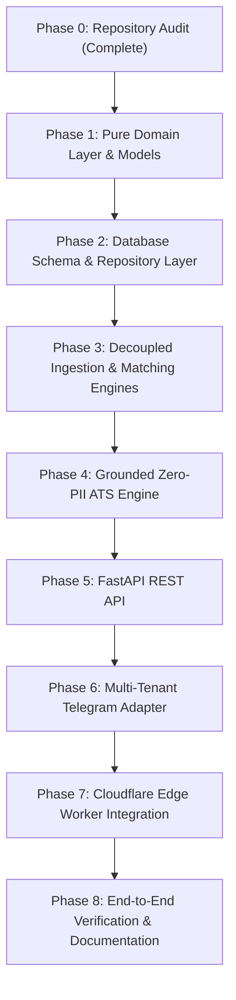

# Acorn Core — Phase 0 Repository Audit
**Document Version:** 1.0.0  
**Audit Date:** October 28, 2026  
**Auditor:** Antigravity Principal Architecture Engine  
**Target Repository:** `mtk7zt/Acorn`  
**Specification Reference:** ACORN CORE: Production Engineering Implementation Specification (v2.0)  

---

## 1. Executive Summary & Audit Scope

This audit provides a comprehensive, ground-truth inspection of the current repository structure, code assets, data flows, operational dependencies, and architectural assumptions of **Acorn**.

Acorn currently operates as an automated, single-tenant Canadian tech job tracker executing batch harvesting via GitHub Actions every 10 minutes, coupled with an interactive Telegram conversational interface powered by a Cloudflare Edge Worker and Google Gemini Flash models.

The purpose of this audit is to baseline existing code before initiating the phased transformation into **Acorn Core**—a multi-tenant, omnichannel Personal Career Intelligence Engine.

### Core Audit Principles Enforced:
1. **Zero Disruption to Existing Functionality:** The live Telegram bot, GitHub Actions harvesting cron, and Cloudflare Worker webhook gateway must remain unbroken throughout all migration phases.
2. **Strict Provenance & Grounded Truth:** Distinguish directly observed job attributes (e.g., scraped applicant counts) from inferred signals (e.g., discovery age). Never fabricate job market stats or candidate metrics.
3. **Provable PII Safety & Data Sovereignty:** In-memory redaction for all candidate identifiers; zero persistence of raw resumes; user-controlled data wipeout protocols.
4. **Architectural Clarity:** Preserve clean GoF architectural separation (Domain, Application, Infrastructure, Interfaces) and avoid premature distributed microservices in favor of a robust modular monolith.

---

## 2. Comprehensive Component Audit

```
Acorn Architecture Inventory Map:
.
├── .github/workflows/
│   ├── job_tracker.yml             # 10-min GHA cron batch harvester
│   └── deploy_worker.yml           # Auto-deploy Cloudflare Worker on push
├── cloudflare-worker/
│   ├── index.js                    # Webhook gateway, Gemini failover, edge ATS
│   ├── package.json                # Worker NPM package (wrangler ^3.0.0)
│   └── wrangler.toml               # KV binding (CHAT_HISTORY), nodejs_compat
├── docs/                           # Architecture specifications & user guides
├── src/acorn/
│   ├── application/
│   │   ├── config.py               # JSON config loader & location mappings
│   │   └── pipeline.py             # Single-tenant batch orchestrator facade
│   ├── domain/
│   │   ├── exceptions.py           # Domain exception taxonomy
│   │   ├── filtering.py            # Token-matching role relevance & senior suppression
│   │   ├── geofence.py             # Canadian geofencing (GTA tiers & remote)
│   │   ├── models.py               # JobListing, PriorityTier, VelocityRank, Config
│   │   ├── security.py             # In-memory PII redaction & ATS keyword match
│   │   └── velocity.py             # First-mover velocity ranking & applicant parsing
│   ├── infrastructure/
│   │   ├── notifiers/telegram.py   # Telegram HTML alert dispatcher (3-row keyboard)
│   │   ├── scrapers/               # LinkedIn, Job Bank Canada, JobSpy multi-board
│   │   └── storage/json_store.py   # Atomic POSIX/Windows JSON state store
│   └── interfaces/                 # BaseJobScraper, BaseNotifier, BaseStateStore
├── terraform/                      # Cloudflare Worker, KV & Route IaC
├── tests/                          # 18 pytest unit tests (100% passing)
├── job_tracker_bot.py              # CLI entrypoint for batch execution
├── setup_webhook.py                # One-time Telegram webhook registration utility
├── requirements.txt                # Python runtime dependencies
└── pytest.ini                      # Test runner configuration (pythonpath = .)
```

---

### Component 2.1: Job Ingestion Engine
- **Files:**
  - `src/acorn/infrastructure/scrapers/factory.py`
  - `src/acorn/infrastructure/scrapers/linkedin.py`
  - `src/acorn/infrastructure/scrapers/jobbank.py`
  - `src/acorn/infrastructure/scrapers/jobspy_adapter.py`
  - `src/acorn/interfaces/scraper.py`
- **Current Behavior:**
  - `ScraperFactory.create_default_scrapers()` instantiates three scraper strategies:
    1. **LinkedInGuestScraper:** Queries public unauthenticated guest search endpoints (`/jobs-guest/jobs/api/seeMoreJobPostings/search`), parses applicant counts (e.g. `"Be among the first 25 applicants"`, `"3 applicants"`), detects reposted flags, and returns `JobListing` objects.
    2. **JobBankScraper:** Queries the official Government of Canada Job Bank portal (`jobbank.gc.ca`) with newest-first date ordering (`sort=D`). Scrapes detail snippets and detects verified postings.
    3. **JobSpyScraper:** Adapter wrapping `python-jobspy` aggregating Indeed Canada, LinkedIn, Glassdoor, and Google Jobs.
- **Single-Tenant Hardcoding / Assumptions:**
  - Ingestion loop directly accepts a single global list of `roles` and searches them sequentially for a single user's hardcoded locations.
  - Ingestion and notification are tightly coupled inside `JobTrackingPipeline.run()`.
- **Verdict:** **Reuse Core Ingestion Logic; Refactor Orchestration.** The scrapers produce clean `JobListing` domain objects. They must be extracted into a shared background ingestion service decoupled from single-user role loops.

---

### Component 2.2: Deduplication Subsystem
- **Files:**
  - `src/acorn/domain/models.py` (`JobListing.compute_fingerprint`, `JobListing.id`)
  - `src/acorn/infrastructure/storage/json_store.py` (`load_seen_jobs`, `save_seen_jobs`)
- **Current Behavior:**
  - **Dual-Key Deduplication:** Uses two distinct keys:
    1. **Primary ID:** Source-prefixed unique ID (e.g. `li_12345678`, `jb_98765432`, `js_hash`).
    2. **Canonical Content Fingerprint:** SHA-256 hash computed over normalized `(company, title, location)`: `fp_` + 16 hexadecimal characters. Normalization lowercases and strips punctuation (`re.sub(r'[^a-z0-9]+', '', text)`).
  - Both keys are stored in `seen_jobs.json` with UTC ISO timestamps.
  - Automatic 7-day TTL pruning removes entries older than 7 days upon loading.
- **Single-Tenant Hardcoding / Assumptions:**
  - A single flat JSON map `seen_jobs.json` stores all seen keys. If key is present, job is completely skipped.
  - In a multi-tenant world, **shared ingestion deduplication** (is this job already known to Acorn?) must be separated from **user signal delivery tracking** (has User X been notified of this job?).
- **Verdict:** **Reuse Dual-Key Hashing; Refactor Storage Schema.** The dual-key canonical fingerprinting algorithm is mathematically sound and verified by `test_dual_key_fingerprint_generation`. It will become the foundational indexing key in PostgreSQL/SQLite `opportunities` table.

---

### Component 2.3: Telegram Alerting & Webhooks
- **Files:**
  - `src/acorn/infrastructure/notifiers/telegram.py`
  - `cloudflare-worker/index.js`
  - `setup_webhook.py`
- **Current Behavior:**
  - **Outbound Alerts:** `TelegramNotifier` formats HTML job alerts with priority badging, velocity tiering, role, company, location, and sanitizes descriptions to max 260 chars.
  - **3-Row Interactive Keyboard:**
    - Row 1: `[🚀 Apply on <Source>]` (Direct URL)
    - Row 2: `[➕ Add Job Role]` (`add_role_prompt`), `[📋 Manage Roles]` (`list_roles`)
    - Row 3: `[📄 ATS Resume Check]` (`ats_prompt`), `[🗑️ Wipe My Data]` (`wipe_prompt`)
  - **Inbound Webhook Handling:** Handled entirely by `cloudflare-worker/index.js` running on Cloudflare V8 edge.
  - **Fail-Closed Security:** Validates `X-Telegram-Bot-Api-Secret-Token` against `env.TELEGRAM_SECRET_TOKEN` (HTTP 401 if invalid).
  - **Authorization:** Restricts commands to `env.ALLOWED_CHAT_IDS`.
- **Single-Tenant Hardcoding / Assumptions:**
  - Python notifier only reads a single `TELEGRAM_CHAT_ID`.
  - Worker modifies `roles_config.json` in the GitHub repo via GitHub REST API commit (`ghPutWithRetry`).
- **Verdict:** **Preserve Telegram UX; Adapt Backend to Acorn Core Omnichannel Bus.** Maintain the exact same 3-row keyboard and callback signatures, but route actions through the multi-tenant `TelegramAdapter`.

---

### Component 2.4: Resume Engine & ATS Scaffolding
- **Files:**
  - `src/acorn/domain/security.py`
  - `cloudflare-worker/index.js`
- **Current Behavior:**
  - **In-Memory PII Redaction:** Regex-based scrubbing removes emails, phone numbers, Canadian postal codes (`A1A 1A1`), SIN/SSN, and LinkedIn profile URLs.
  - **ATS Keyword Matching:** Compares candidate resume text against canonical tech keywords (`CANONICAL_TECH_KEYWORDS`) and computes match percentage.
  - **XYZ Bullet Suggestions:** Generates Google XYZ-formula bullets (`"Accomplished [X] as measured by [Y], by doing [Z]"`).
- **Flaws & Critical Audit Finding:**
  - In `src/acorn/domain/security.py` (lines 105-119), bullets contain **hardcoded, ungrounded metrics**:
    - *"Accomplished 99.9% application uptime as measured by Prometheus monitoring..."*
    - *"Accelerated query execution latency by 35% as measured by APM logs..."*
    - *"Resolved 45+ daily technical tickets maintaining a 98% first-contact SLA..."*
  - This directly violates the core engineering directive: **Never fabricate achievements, metrics, employer names, or unverified claims.**
- **Verdict:** **Refactor Immediately.** Replace hardcoded metrics with structural scaffolding referencing candidate-supplied skills and verifiable experience without inventing percentages or metric numbers.

---

### Component 2.5: State Storage
- **Files:**
  - `src/acorn/infrastructure/storage/json_store.py`
  - `seen_jobs.json`
  - `roles_config.json`
  - `bot_config.json`
- **Current Behavior:**
  - `AtomicJsonStateStore` uses `tempfile.NamedTemporaryFile` + `os.replace` to guarantee atomic writes on POSIX and Windows.
  - State files are committed to Git by GitHub Actions (`chore: update job tracker state [skip ci]`).
- **Bottlenecks:**
  - Git repository used as a database causes merge conflicts, commit churn, and restricts the system to a single user.
  - Does not support multi-tenant query isolation, concurrency, or relational querying.
- **Verdict:** **Refactor to Repository Pattern (SQLAlchemy 2.x / Alembic).** Provide PostgreSQL for SaaS production, SQLite for local development and CI testing, while preserving `AtomicJsonStateStore` as a fallback adapter for standalone single-user CLI runs.

---

### Component 2.6: Cloudflare Edge Worker
- **Files:**
  - `cloudflare-worker/index.js`
  - `cloudflare-worker/wrangler.toml`
  - `cloudflare-worker/package.json`
- **Current Behavior:**
  - Acts as the conversational AI brain and Telegram webhook server.
  - Manages conversational history (up to 50 turns) stored in Cloudflare Workers KV (`CHAT_HISTORY`).
  - Implements dynamic model discovery and failover ranking across Google Gemini models:
    `gemini-flash-latest`, `gemini-3.7-flash`, `gemini-3.5-flash`, `gemini-3.8-flash`, `gemini-flash-lite-latest` with a 6-second timeout.
- **Single-Tenant Hardcoding:**
  - Hardcoded to inspect `ALLOWED_CHAT_IDS`.
  - Directly commits changes to `roles_config.json` in GitHub repo.
- **Verdict:** **Retain Edge Performance; Extend to Omni-Gateway.** Keep KV session caching and Gemini failover logic, but connect worker to Acorn Core REST API for tenant resolution, preference syncing, and briefings.

---

### Component 2.7: Test Suite
- **Files:**
  - `tests/test_filtering.py` (5 tests)
  - `tests/test_geofence.py` (6 tests)
  - `tests/test_security.py` (2 tests)
  - `tests/test_storage.py` (2 tests)
  - `tests/test_velocity.py` (3 tests)
  - `pytest.ini`
- **Current Status:**
  - All 18 tests pass in ~0.15 seconds (`.\venv\Scripts\python.exe -m pytest`).
- **Gaps Identified:**
  - No end-to-end integration tests for multi-tenant pipeline execution.
  - No tests for REST API endpoints (FastAPI).
  - No tests verifying that XYZ bullets do not contain fabricated metrics.
- **Verdict:** **Retain 100% of Existing Tests; Expand Suite.** Existing unit tests establish core domain invariants. New tests will be added in Phase 1-7.

---

### Component 2.8: Dependencies
- **Current `requirements.txt`:**
  - `python-jobspy>=0.1.0`
  - `requests>=2.31.0`
  - `beautifulsoup4>=4.12.0`
  - `pandas>=2.0.0`
  - `pytest>=8.0.0`
- **Upgrade Requirements for Acorn Core:**
  - `fastapi>=0.110.0` (REST API layer)
  - `uvicorn[standard]>=0.28.0` (ASGI server)
  - `sqlalchemy>=2.0.25` (Relational persistence)
  - `alembic>=1.13.0` (Database migrations)
  - `pydantic>=2.6.0` (Data validation and settings)
  - `pydantic-settings>=2.2.0` (Environment config)
- **Verdict:** **Targeted Dependency Upgrades.** Add enterprise web and ORM packages without removing existing scraping libraries.

---

### Component 2.9: Deployment & Infrastructure as Code (IaC)
- **Files:**
  - `terraform/main.tf`, `variables.tf`, `outputs.tf`
  - `.github/workflows/job_tracker.yml`
  - `.github/workflows/deploy_worker.yml`
- **Current Behavior:**
  - Terraform manages Cloudflare Worker script, KV namespace binding, and secrets.
  - GitHub Actions runs `job_tracker_bot.py` every 10 minutes and commits updated state files.
- **Verdict:** **Maintain Existing Infrastructure; Introduce Cloud Relational Database.**

---

## 3. Source of Truth & Data Flows

### Current Flow (Single-Tenant):
```
[External Boards] 
       │
       ▼ (Every 10 min)
[JobSpy / LinkedIn / JobBank]
       │
       ▼
[JobTrackingPipeline] ──► Filter / Geofence / Velocity / Dedup
       │
       ├──► seen_jobs.json (Local Git Commit)
       └──► TelegramNotifier (Dispatches to single TELEGRAM_CHAT_ID)
```

### Acorn Core Target Flow (Multi-Tenant & Omnichannel):
```
               SHARED INGESTION & DISCOVERY (Background)
                                  │
      ┌───────────────────────────┼───────────────────────────┐
      │                           │                           │
LinkedIn Guest API         Job Bank Canada CA         JobSpy Multi-Board
      │                           │                           │
      └───────────────────────────┼───────────────────────────┘
                                  ▼
                   [Canonical Opportunity Ingestion]
                     • Dual-Key Content Hashing
                     • Observed Velocity Extraction
                     • Ingestion Audit Logging
                                  │
                                  ▼
                    PostgreSQL / SQLite Database
                      (Canonical Opportunities)
                                  │
      ┌───────────────────────────┴───────────────────────────┐
      │                                                       │
PERSONALIZED INTELLIGENCE (Per-Tenant)            COMMUNICATION & CHANNELS
      │                                                       │
      ├─ User Preferences (GTA/Remote, Titles)                ├─ Telegram Bot (Interactive Keyboards)
      ├─ Grounded Provenance Evaluation                       ├─ FastAPI REST API (Web & Mobile Apps)
      ├─ Zero-PII ATS Match Engine                            ├─ Cloudflare Edge Gateway
      └─ Morning Briefing & Signal Synthesis                  └─ Audit Activity Stream ("Kept Watch")
```

---

## 4. Single-Tenant Assumptions & Architectural Bottlenecks

| # | Single-Tenant Assumption | Architectural Bottleneck | Target Architecture in Acorn Core |
|---|--------------------------|--------------------------|-----------------------------------|
| 1 | `TELEGRAM_CHAT_ID` loaded from environment | Only one recipient can receive alerts | `User` entity with `ChannelBinding(channel="telegram", address=chat_id)` |
| 2 | `roles_config.json` holds single global array | All searches use identical keywords | Per-user `UserPreferences.target_roles` |
| 3 | `seen_jobs.json` stores all seen keys globally | If Job A is seen once, no other user can ever discover it | Shared `opportunities` table + per-user `signals` delivery tracking table |
| 4 | State committed to Git via GitHub Actions | File locking conflicts, commit noise, rate limits | Relational database (PostgreSQL in production, SQLite in local/CI) |
| 5 | Hardcoded XYZ bullet metrics | Inaccurate, ungrounded claims generated for candidate resumes | Grounded bullet scaffolding referencing only user-verified skills |
| 6 | Direct CLI execution only | Web and mobile clients cannot query opportunities or run ATS check | FastAPI REST API exposing `/v1/signals`, `/v1/briefings`, `/v1/fit` |

---

## 5. Reuse vs. Refactor Assessment Table

| Component | File Path | Assessment | Action Plan |
|---|---|---|---|
| Role Relevance Filtering | `src/acorn/domain/filtering.py` | **REUSE** | Keep core token matching logic; parameterize for per-user preferences. |
| Canadian Geofencing | `src/acorn/domain/geofence.py` | **REUSE** | Keep GTA priority tiers and Canadian remote validation rules. |
| Velocity Classification | `src/acorn/domain/velocity.py` | **REFACTOR** | Explicitly record `applicant_count_observed: bool` to prevent fabricated counts. |
| Zero-PII Redaction | `src/acorn/domain/security.py` | **REUSE & HARDEN** | Retain regex scrubbing; add unit tests for address and handle redaction. |
| ATS Bullet Generation | `src/acorn/domain/security.py` | **REFACTOR** | Remove all fabricated metrics ("35%", "99.9%"); use grounded scaffolding. |
| Job Scrapers | `src/acorn/infrastructure/scrapers/*` | **REUSE** | Wrap in shared ingestion service without altering parsing logic. |
| Atomic JSON Storage | `src/acorn/infrastructure/storage/json_store.py` | **REUSE AS FALLBACK** | Keep for backward-compatible CLI runs; create SQLAlchemy repositories. |
| Telegram Notifier | `src/acorn/infrastructure/notifiers/telegram.py` | **REFACTOR** | Decouple from single `chat_id`; implement `IChannelAdapter`. |
| Pipeline Orchestrator | `src/acorn/application/pipeline.py` | **REFACTOR** | Split into `IngestionService` (shared) and `MatchingService` (per-user). |
| Cloudflare Worker | `cloudflare-worker/index.js` | **REFACTOR** | Connect to Acorn Core API; retain Gemini failover ranking. |

---

## 6. Recommended Migration Sequence (Phases 1 through 8)



- **Phase 1: Extract & Modernize Pure Domain Logic**
  - Establish `src/acorn/domain/` subpackages: `identity`, `opportunities`, `matching`, `signals`, `briefings`, `resumes`, `activity`.
  - Zero external I/O or network dependencies in domain entities.
- **Phase 2: Persistence & Repository Pattern**
  - Implement SQLAlchemy 2.x models and repository interfaces (`IOpportunityRepository`, `IUserRepository`, `ISignalRepository`, `IActivityRepository`).
  - Provide SQLite (local/CI) and PostgreSQL (production) with Alembic migrations.
- **Phase 3: Ingestion & Personalization Decoupling**
  - Decouple background harvesting from user alerting.
  - Implement dual-key canonical opportunity deduplication.
  - Implement per-user signal synthesis with provenance tracking.
- **Phase 4: Grounded Zero-PII ATS Engine**
  - Implement ethical resume evaluation with 100% PII stripping and non-fabricated XYZ scaffolding.
  - Implement complete candidate data wipeout (`purge_user_data`).
- **Phase 5: Acorn Core REST API (FastAPI)**
  - Expose OpenAPI endpoints for SaaS/IaaS consumers, web dashboard, and mobile clients.
- **Phase 6: Multi-Tenant Telegram Adapter**
  - Adapt existing Telegram notification and interactive keyboard logic to support multi-tenant routing.
- **Phase 7: Edge Worker Realignment**
  - Connect Cloudflare Worker to Acorn Core API for authorized multi-user queries and briefings.
- **Phase 8: Comprehensive Verification & Sign-off**
  - Run full test suite, verify CLI backward compatibility, execute test alerts, and deliver final documentation.

---

## 7. Dependency Upgrade Strategy

### New Python Dependencies (Added to `requirements.txt`):
```text
# Web & API
fastapi>=0.110.0
uvicorn[standard]>=0.28.0

# Persistence & Data Validation
sqlalchemy>=2.0.25
alembic>=1.13.0
pydantic>=2.6.0
pydantic-settings>=2.2.0

# Database Drivers
psycopg2-binary>=2.9.9
aiosqlite>=0.20.0
```

All existing dependencies (`python-jobspy`, `requests`, `beautifulsoup4`, `pandas`, `pytest`) are retained with full version compatibility.

---

## 8. Compatibility Risks & Mitigations

1. **Risk:** Breaking the current GitHub Actions cron job (`job_tracker.yml`).
   - **Mitigation:** Keep `job_tracker_bot.py` fully operational as a CLI wrapper delegating to the new core engine or falling back to `AtomicJsonStateStore` if no database URL is set.
2. **Risk:** Disrupting live Telegram bot interactions.
   - **Mitigation:** Retain the exact callback data identifiers (`add_role_prompt`, `list_roles`, `ats_prompt`, `wipe_prompt`) and 3-row keyboard layout.
3. **Risk:** Performance degradation during batch ingestion.
   - **Mitigation:** Dual-key hashing (`(company, title, location)`) indexed in SQL guarantees `O(1)` deduplication lookups.
4. **Risk:** Accidental PII persistence.
   - **Mitigation:** Resumes are processed strictly in-memory; only extracted non-identifying skills and match scores are returned. Zero raw resume text is saved to disk or database.

---
**Audit Approved for Checkpoint Review.**
