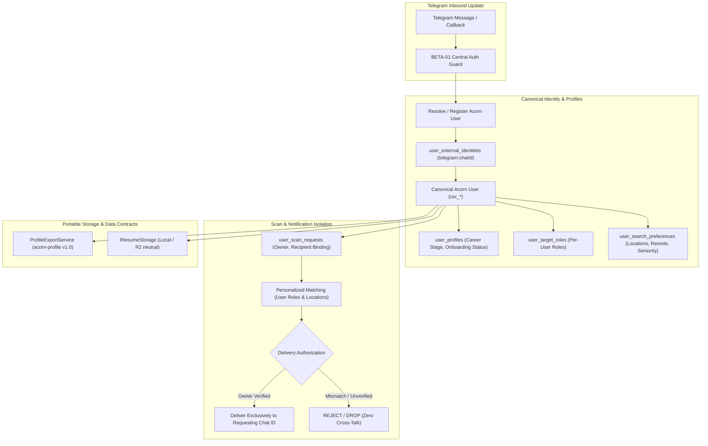

# STAGE BETA-02 — PERSONALIZED USER PROFILES, SCAN ISOLATION & PORTABLE DATA ARCHITECTURE

## Executive Overview
Milestone **BETA-02** corrects the observed cross-user scan-delivery defect, establishes canonical user identities independent of transport protocols, introduces isolated per-user career profiles and target roles, organizes repository runtime files into `data/runtime/`, creates cloud-independent storage contracts for optional resume handling, enables portable profile export/import, and reconciles project documentation.

---

## 1. Root Cause Analysis of User-Isolation Defect

### Observed Incident
A beta tester redeemed an activation key, joined Acorn, and triggered a scan with `/scan`. Acorn did not ask for the tester's target roles, executed the scan, and delivered the results to the **founder's Telegram account** instead of the tester.

### Codebase Root Cause
1. **Cloudflare Worker Hook**: In `cloudflare-worker/index.js`, `/scan` dispatches a GitHub Actions workflow (`ghDispatchWorkflow`) with `{ ref: 'main' }` without passing the requesting user's identity or target roles.
2. **GitHub Actions Workflow**: In `.github/workflows/job_tracker.yml`, `job_tracker_bot.py` is executed with static secret `TELEGRAM_CHAT_ID: ${{ secrets.TELEGRAM_CHAT_ID }}` (the founder's personal Telegram chat ID).
3. **Execution Script**: In `job_tracker_bot.py`, the script loads the static secret `TELEGRAM_CHAT_ID` and global `roles_config.json`, matches jobs against global roles, and transmits notifications directly to that static chat ID.
4. **Missing Profile Layer**: No user-specific profile storage existed; all users shared the root `roles_config.json`.

---

## 2. Architectural Blueprint for BETA-02

---

## 3. Detailed Phase Breakdown

### Phase 0: Baseline Verification & Audit
- Ensure 44/44 tests pass.
- Verify existing branch state and files.

### Phase 1: Fix Scan Routing Defect & Strict Delivery Binding
- Update `job_tracker_bot.py` to accept `--chat-id`, `--user-id`, and `--roles` overrides when executing targeted scans.
- In `cloudflare-worker/index.js`, ensure `/scan` resolves the authenticated user's profile and target roles:
  - If user has no target roles set, prompts onboarding: *"Please set your target roles with `/setroles` before scanning!"*
  - Passes user context to scan execution.
  - Ensures all notifications are routed strictly to the requester's `chatId`.
  - Disallows fallback to `TELEGRAM_CHAT_ID` or founder ID when a tester initiates a scan.

### Phase 2: Canonical User Identity
- Introduce `acorn_user_id` generation (`usr_<uuid>`).
- Map `user_external_identities` (`telegram` -> `chatId`).
- Maintain seamless integration with BETA-01 `user_access_grants`.

### Phase 3: Profile Database Schema (Additive D1 & SQLite)
- Create `migrations/0003_user_profiles_and_portability.sql`:
  - `acorn_users`
  - `user_external_identities`
  - `user_profiles`
  - `user_target_roles`
  - `user_search_preferences`
  - `user_resume_assets`
  - `user_scan_requests`
- Create `migrations/0003_rollback.sql`.

### Phase 4: Telegram Onboarding & Profile Management
- Implement interactive commands:
  - `/profile`: Shows current user's profile, active roles, location preferences, and resume status.
  - `/setroles <role1, role2, ...>`: Adds/updates personalized target roles.
  - `/setlocations <loc1, loc2, ...>`: Sets preferred geographic locations.
  - `/preferences`: Configures remote/hybrid, seniority, notification cadence.
  - `/uploadresume`: Provides secure upload instructions with security & privacy notices.
  - `/deleteresume`: Safely purges resume assets and metadata.
  - `/exportprofile`: Downloads versioned `acorn-profile` JSON.

### Phase 5: Personalized Matching & Isolated Signals
- Evaluate candidate opportunities against the requesting user's specific target roles and locations.
- Ensure signals generated belong exclusively to that user.

### Phase 6: Organize Existing Operational Files
- Move non-sensitive operational files from repository root into dedicated directories:
  - `seen_jobs.json` -> `data/runtime/ingestion/seen_jobs.json`
  - `roles_config.json` -> `data/runtime/config/roles_config.json`
  - `bot_config.json` -> `data/runtime/config/bot_config.json`
- Preserve 100% of deduplication history in `seen_jobs.json`.
- Add `ACORN_DATA_DIR` environment variable with backward compatibility.
- Update all Python modules, tests, and GitHub Actions workflows.

### Phase 7: Cloud-Independent Storage Architecture
- Define `IResumeStorage` protocol with implementations:
  - `LocalPrivateStorageAdapter` (stores in private gitignored directory).
  - `CloudflareR2StorageAdapter` (neutral provider interface, unprovisioned by default).
- File validation: PDF/DOCX signature check, 5MB limit, quarantine workflow.

### Phase 8: Portable Profile Export & Import
- Implement `acorn-profile` v1.0 schema:
  - Clean JSON export with profile, roles, preferences, notification settings, and resume metadata.
  - Validation, conflict handling, and idempotency.

### Phase 9: Documentation Reconciliation
- Reconcile README with actual test metrics (44 passing), actual Gemini configuration, BETA-01 activation, and BETA-02 personalized profiles.

### Phase 10: Automated Verification Suite
- Mandatory regression test: Tester `/scan` -> Founder receives 0 messages, Tester receives results.
- Mandatory two-user concurrency test: User A (Backend in Toronto) vs User B (Data Analyst in Vancouver).
- Identity, profile, and portability test suite.

---

## 4. Verification Plan

### Automated Tests
- `pytest tests/test_user_isolation.py -v`: Tests cross-user scan delivery defect and two-user concurrent isolation.
- `pytest tests/test_user_profiles.py -v`: Tests identity resolution, profile mutations, and roles.
- `pytest tests/test_profile_portability.py -v`: Tests export and import schema validation.
- `pytest tests/test_runtime_storage_relocation.py -v`: Tests `data/runtime/` path resolution and deduplication preservation.
- Full suite execution: `pytest tests/ -v`.
